### von Rainer Luniak

***aktualisiert 28.07.2020***

Einige von Euch werden sich erinnern dass am Anfang meines Bauberichtes von der Do 24 - die mittlerweile herrlich fliegt – bei der Wahl des Vorbilds auch die Do X in der engeren Auswahl stand.

Nach Abwägung der vielen den Bau beeinflussenden Fakten habe ich mich für die folgende Ausführung entschieden bei der die oberste Zielsetzung ein Abfluggewicht unter der 5 kg-Grenze war.

Vorbild wir nicht die allseits bekannte und bereits mehrfach als Modell nachgebaute deutsche Maschine vom Weltflug 1929 werden. Es wurden ja damals von Dornier 3 mehr oder weniger baugleiche Muster gebaut wovon 2 Maschinen an Italien verkauft wurden.

Ich habe mich für die italienische, auf den Namen **„Alessandro Guidoni“** getaufte Maschine mit der Kennung **I-ABBN**entschieden – auch wegen der vollverkleideten Motorpylone – was den Bauaufwand etwas reduziert.

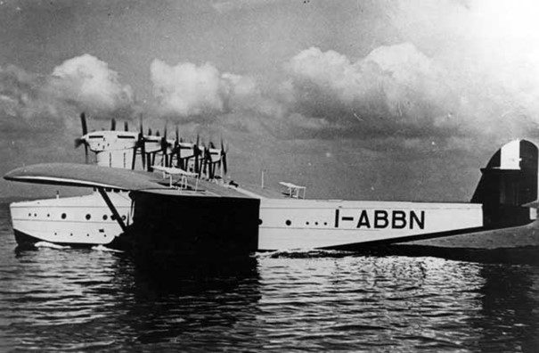

Als Motorisierung sind vorgesehen 6 Stück Koptermotore 2206, 2600 KV an 2x 2S1P Lipos. Damit kann gegenüber Standardmotoren an 3S-Lipos ca. 500 Gramm eingespart werden.

Rumpf und Leitwerk werden in der bewährten Hartschaumplatten-Technik erstellt, wobei jedoch vermehrt 9 mm Depron zum Einsatz kommt.

Der Flügel wird in konventioneller Balsaholz-Holm / Rippenbauweise mit Oratex-Bespannung erstellt werden. Die Motorpylone werden aus Depron erstellt.

|  |  |  |
| --- | --- | --- |
| **Dornier Do X** | **Original** | **Modell** |
| Spannweite | 48,0 m | 2,15 m |
| 40,1 m | Original | 1,70 m |
| Gewicht leer | 28250 kg | 4,9 kg |
| Gewicht max. | 52000 kg | 4,9 kg |
| Antrieb | 12 x V12 Curtiss  je 470 KW | 6 x 320 W |

Derzeitiger Bauzustand wie auf den folgenden Fotos:

Untere Rumpfpartie – Vorderteil bis zur Stufe aus 60 mm Platte Hartschaum aus dem Vollen gearbeitet – Hinterteil ab Stufe aus 20 mm Hartschaumplatte hergestellt – Stützschwimmer aus 60 mm Hartschaum mit dem heißen Draht geschnitten.

Spanten und Akkuschacht aus 9 mm Depron.

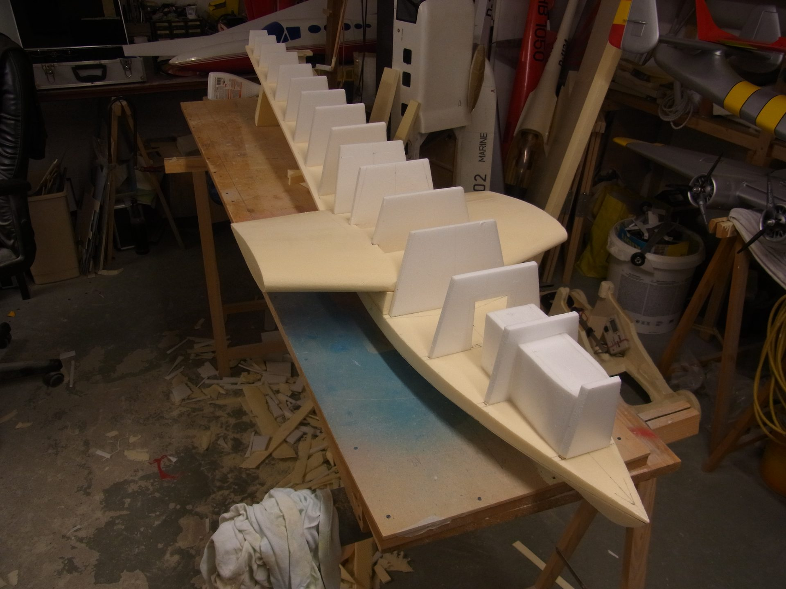

Auch die bereits rohbaufertigen Motorpylone sind aus 9 mm Depron mehrschichtig hergestellt.

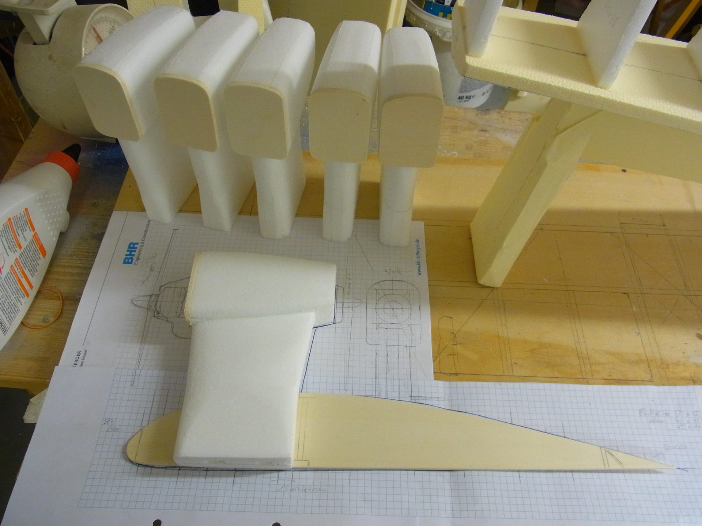

**Teil 2 entsprechend dem aktuellen Bauzustand am 10.04.2020:**

Corona treibt ein seltsames Spiel mit uns, einerseits wir man in den Keller verbannt und der Baufortschritt nimmt rasant an Fahrt auf, andererseits gibt es mittlerweile gravierende Engpässe bei einigen Materialien und Teilen.

Aktuell sieht die Do X wie folgt aus:

Der Rumpf ist mittlerweile geschlossen, Seitenwände auch aus 9 mm Depron, oberer Rumpfabschluss aus 20 mm Hartschaumplatten. Tragflächenauflage und die Brücke (Steuerhaus) sind rohbaufertig. Das Ganze soll mit 80 gr. Glasgewebe belegt werden.

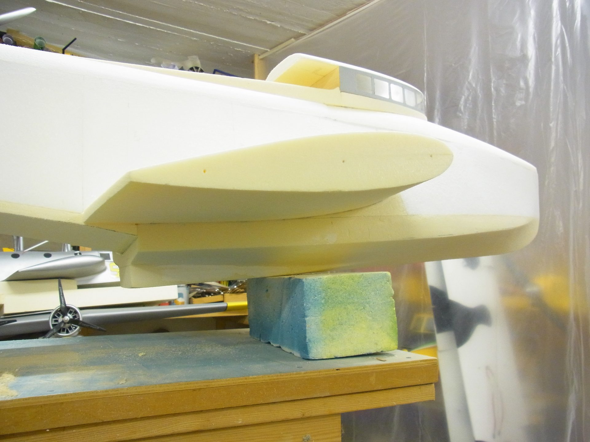

Das komplexe Leitwerk wurde aus Festigkeitsgründen nicht wie geplant aus Depron erstellt, dies schien mir bei dem hochgesetzten Höhenleitwerk zu gewagt.

Das komplette Leitwerk ist zum Transport abnehmbar und wird mit zwei Kohlerohren 10 und 6 mm fixiert. Das Höhenleitwerk ist aus Styropor mit 0,8 mm Abachifurnier, die runden Randbogen aus Hartschaum mit 80 gr. Glasgewebe belegt.

Das Seitenleitwerk ist klassisch aus leichtem Pappelsperrholz und Balsa erstellt, das Seitenruder ist wie die Randbogen aus Hartschaum mit Glasgewebe.

Zusammen mit der im Rumpf eingebauten Führung für die Kohlerohrsteckung, jedoch ohne Servos bringt das komplette Leitwerk 300 Gramm im Rohbau auf die Waage. Dazu werden 3 Servos mit je 13 gr. und 2,5 kg/cm Stellmoment kommen.

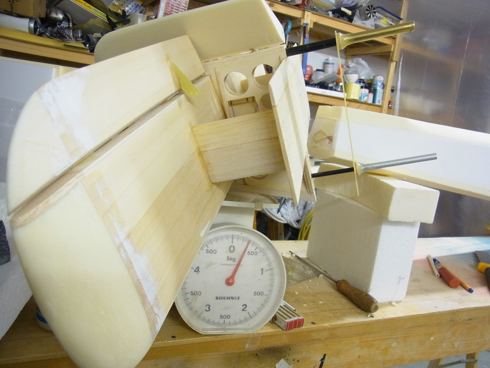

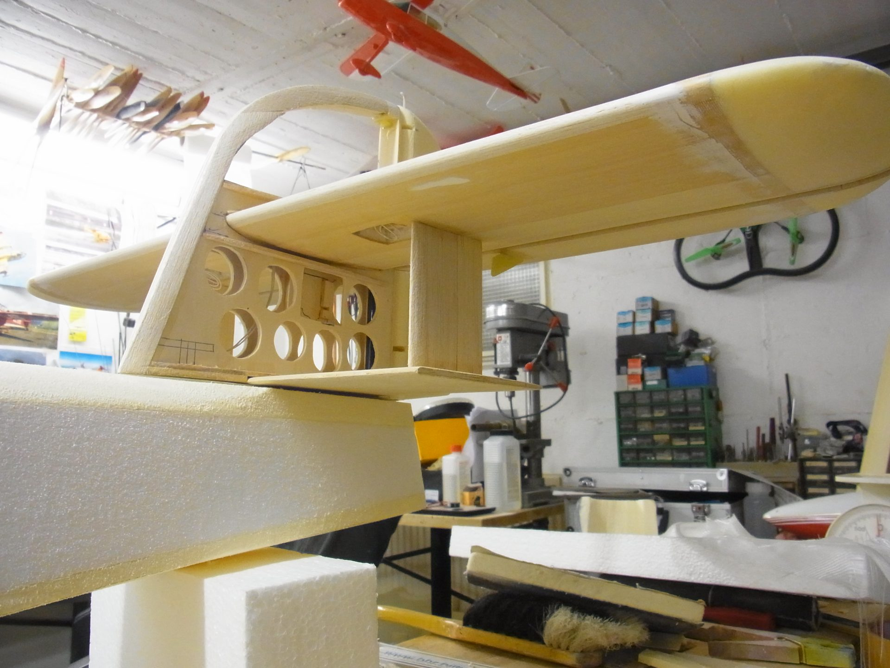

Die Motorisierung ist derzeit wieder vollkommen offen da aus bekannten Gründen keine Ware aus China kommt und die Bestände hier stark geschrumpft sind sodass eine sinnvolle Auswahl nicht möglich ist.

Ähnlich ist es mit der Liefermöglichkeit von Balsaholz, ein Lieferant bei dem ich schon mal gekauft habe, dessen Bestand im Shop nahezu komplett nicht lieferbar ist hat mir auf Nachfrage geantwortet dass er bereits seit November 2019 keine Lieferung aus Südamerika erhält weil von China Spitzenpreise für Balsaholz aller Qualitäten gezahlt wird. Hintergrund-dort werden Windkraftanlagen in immensen Stückzahlen gebaut und das Balsa wird als Stützkonstruktion in die Rotorblätter gestopft !!!

Nun habe ich doch einen Lieferanten gefunden –am nächsten Mittwoch soll die Lieferung eintreffen, bin mal gespannt was da für eine Qualität ankommt. Wenn die passt geht der Aufbau des Tragflügels los.

Das wird im nächsten Abschnitt zu sehen und zu lesen sein.

Bis dahin hoffe ich es geht allen Vereinskameraden gut auch wenn wir uns derzeit nicht auf dem Flugplatz treffen können – bleibt gesund und baut fleißig Modelle !

**Teil 3 entsprechend dem Bauzustand vom 20.06.2020**

Der Aufbau der Tragfläche hat einen riesigen Spaß gemacht, die Holzwürmer unter Euch können das sicher nachvollziehen – aber vielleicht traut sich auch mal ein eingefleischter Schaumwaffelflieger an so ein Projekt.

Da der Flügel einen rechteckigen Grundriss hat war das Herstellen eines Rippenblocks mit 4 Sperrholzrippen und 32 Balsarippen sehr schnell erledigt. Zwei Hauptholme aus 13x6 mm Kiefer auf die ganze Spannweite mit 3 mm Balsa zu einem T-Profil verkastet tragen die Last. Rippen aus 3 mm Balsa mit Aufleimer 2 mm Balsa, Beplankung 2 mm Balsa. Die 4 mm Sperrholzrippen sitzen 2x in der Flügelmitte um die Last der Flächenschrauben aufzunehmen und je eine an der Stelle der Lasteinleitung der Flächenstützen. Mit dem Verschleifen der 10x30 mm Nasenleiste war der Flügelrohbau bereits nach einer Woche erledigt.

Die recht großen Randbögen 150x400 mm wurden aus mehreren Schichten Depron und 20er Isolierschaumplatten innen hohl aufgebaut, geschliffen und mit 80 gr. –Gewebe laminiert und dann stumpf an die äußeren Rippen geleimt.

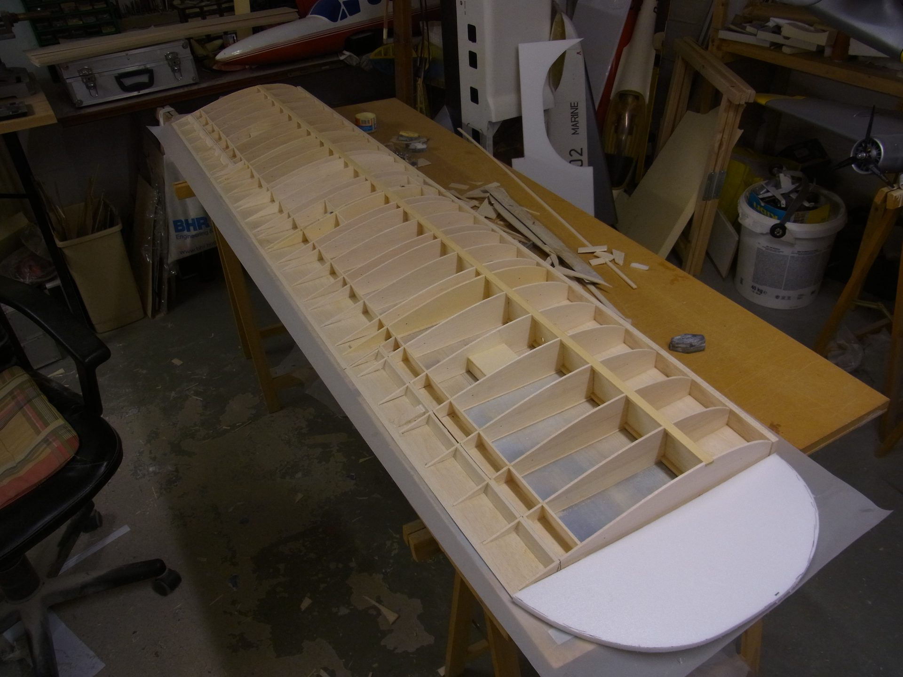

Vor dem Aufbringen der oberen Beplankung nahmen die vorgefertigten Motorpylone ihren Platz ein und die komplette Verkabelung des Flügels und des Antriebs musste eingebaut werden.

Die Querruder wurden ausgeschnitten, verkastet und Ruderhörner aus 1,5 mm GfK-Platten angefertigt und eingeklebt . Es folgte der Einbau der Querruderservos, hier zwei Standard- 7 kgcm Servos.

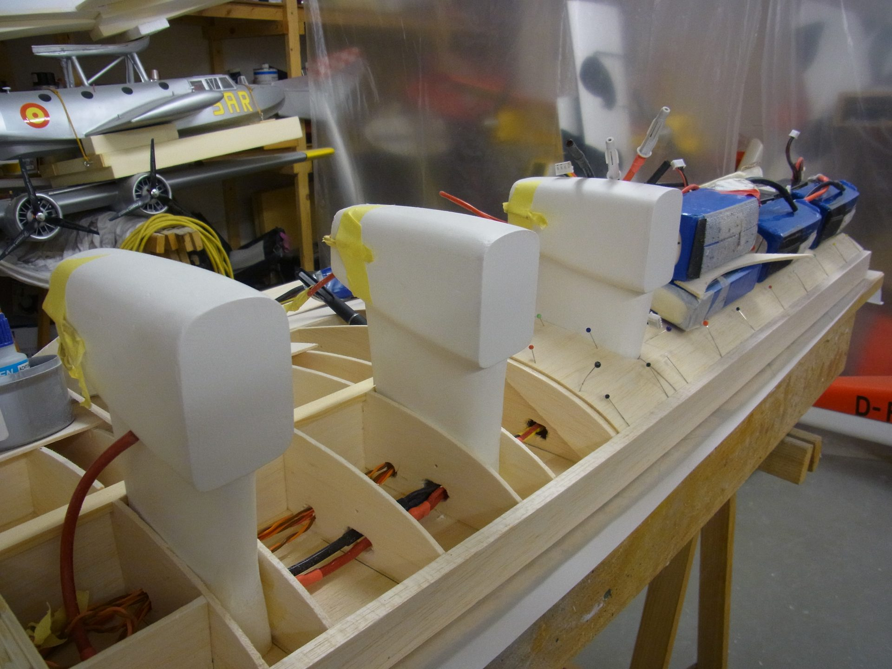

Weiter geht es mit dem Rumpf und zwar mit der Anfertigung der hinteren Stufe aus einer Hartschaumplatte sowie dem Einbau und der Anlenkung des Wasserruders.

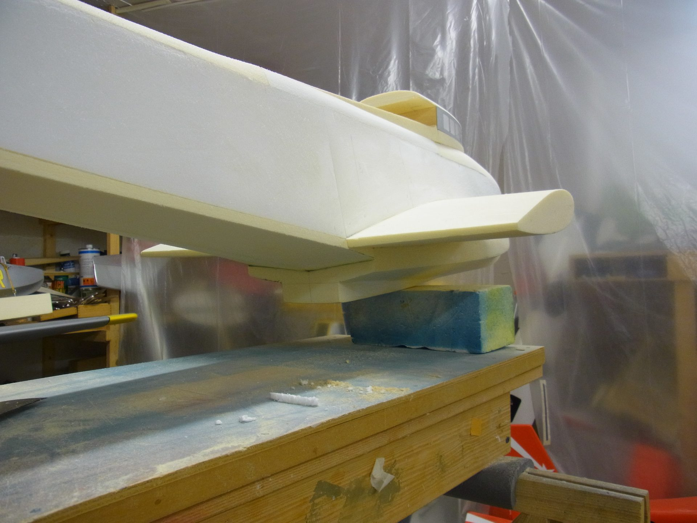

Nach dem Verschließen der Rumpföffnung für die Ruderanlenkung folgte das Aufbringen der Glasfaserbeschichtung mit Epoxidharz und 80 gr. –Glasgewebe auf dem gesamten Rumpf.

Daran schließt sich die unangenehmste Arbeit der ganzen Bauphase an – das mehrfache Verschleifen, Spachteln und Grundieren der gesamten Rumpfoberfläche. Allerdings habe ich mir bei diesem Modell nicht zum Ziel gesetzt eine möglichst makellose, glatte Oberfläche zu erzielen.

Zum Einen war das beim Original sicher auch nicht der Fall, zum Anderen wollte ich dass die Gewebestruktur auch nach der silbernen Endbeschichtung noch erkennbar ist da Flügel und Leitwerk mit Oratex-Gewebefolie bespannt werden und somit am ganzen Modell ein Oberflächeneffekt mit Gewebecharakter vorliegt.

Nachdem die erste Grundierung aufgebracht war wurden die Stützen zwischen Rumpf und Stützkörper aus 5 mm Kohlerohr eingebaut. Die Flächenstützen wurden ebenfalls aus 5 mm Kohlerohr hergestellt. Sie sind an der Tragfläche mit einem Drehgelenk angeschlagen und werden mit den im Stützkörper eingeharzten Gegenstummeln durch einen über geschobenen Kunststoffschlauch verbunden. Dadurch ist der Aufbau am Startplatz recht einfach.

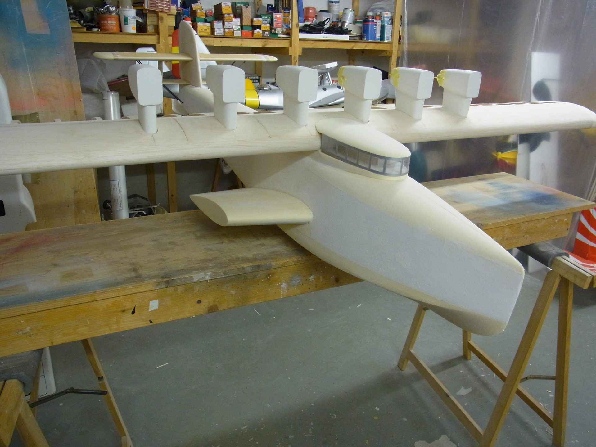

Noch unfertig aber doch schon eine imposante Erscheinung.

Nun geht es in Richtung Finish. Mittlerweile sind auch die Motore eingetroffen. Entgegen der am Anfang des Berichts angepeilten Antriebsauslegung wird diese nun wie folgt aussehen:

Auf Grund der erforderlichen Schwerpunkt -Ballastierung werden zwei 5000mAh – 3S1P – Lipos in der äußersten Rumpfspitze benötigt. Daher ist die Wahl auf 6 Standardmotore der Größe 2830 /1300 KV mit 4-Blatt-Propeller gefallen. Mit 6x4,5 Zoll 4-Blatt erzeugen diese Motore je 720 Gramm Standschub bei 13,5 A Stromaufnahme. Bei einem Startschub von ca. 4,3 KG sollte das Abwassern kein Problem sein und im Flug kann sicherlich die Leistung weit zurückgenommen werden.

Ein Wermutstropfen zum vorläufigen Schluss: Die angepeilte 5,0 KG-Gewichtsgrenze ist mit dieser Auslegung höchstwahrscheinlich nicht zu realisieren.

Ich melde mich mit der Fortsetzung nach dem abschließenden Finish, von einer Flugerprobung auf dem Rodgauer Freibadsee im laufenden Jahr kann man ja derzeit nur träumen.

**Teil 4: Fertigstellung**

Das Finish ist nun auch abgeschlossen. Der mit Felgensilber aus dem Baumarkt lackierte Rumpf wurde mit den runden Fenstern und den schwarzen Streifen welche die Verstärkungen in Längsrichtung imitieren aus DC-Fix-Folie erstellt. Die Rumpfunterseite wurde wie beim Original in Schwarz gehalten. Die Kennungen und Schriftzüge hat wieder unser Vereinsmitglied Stefan Langhammer erstellt – vielen Dank nochmals.

Die im vorhergehenden Abschnitt genannten Motore wurden eingebaut und die jeweils 30 A-Regler in den Motorgondeln montiert. Die Kabelverbindungen im gesamten Flügel-und Antriebsbereich wurden allesamt gelötet und somit Unmengen von Steckverbindungen eingespart.

Die sechs Druckpropeller sind lediglich Attrappen und mit einer zentralen Schraube abnehmbar fixiert.

Nachdem nun auch nach immerhin 4 Monaten und einigen e-mails  die drei Leitwerkservos geliefert wurden konnte auch das Leitwerk fertig gestellt werden. Die Verbindung zum Empfänger erfolgte mit einer grünen Multiplex Steckverbindung deren Kabelanschlüsse mit Heißsiegelkleber wasserdicht gemacht wurden. Nach der endgültigen Schwerpunktbestimmung liegt das Gesamt-Fluggewicht nunmehr bei 6,5 Kg – Ziel stark verfehlt – aber bei  77 Gramm /dm2 Flächenbelastung noch locker fliegbar.

Rein optisch kann man von einem gelungenen Modell sprechen wie die folgenden Fotos beweisen. (Bitte stört euch nicht an der Unordnung in meinem Bastelkeller) Eine flugtechnische Erprobung wird wohl nach Stand der Dinge erst anlässlich unserer Veranstaltung am 10. Und 11. Oktober 2020 stattfinden können.

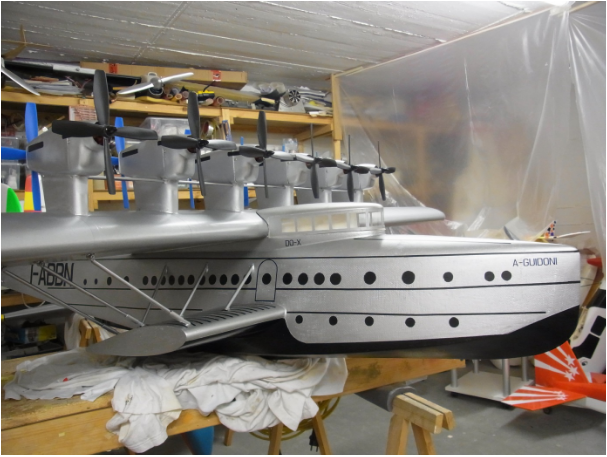

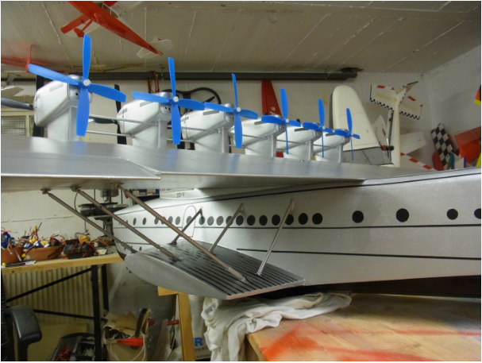

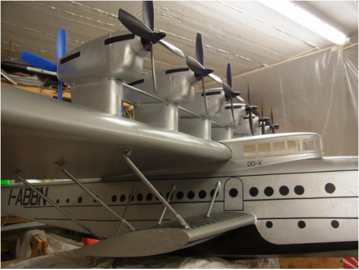

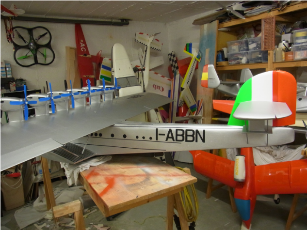

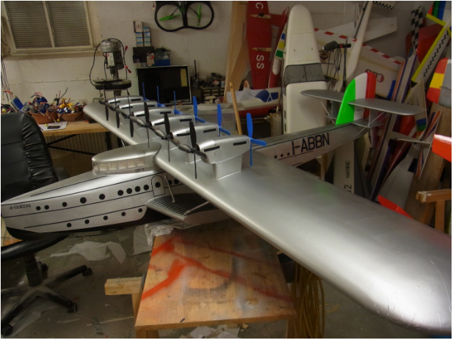

**Zum Schlussnoch etwas Historie:(enthält Auszüge aus WIKIPEDIA)**

Die Do X war zu seiner Zeit das mit Abstand größte Flugzeug der Welt. Wie sehr  die Dornierwerke und Ihre Ingenieure damit Ihrer Zeit voraus waren lässt sich auch daran erkennen dass der 1929 aufgestellte Rekord mit 169 Passagieren erst mehr als 20 Jahre später durch die Lockheed Constellation  gebrochen wurde.

Die Produktion von insgesamt 3 Baumustern erfolgte von 1928 bis 1931 auf dem Werftgelände im schweizerischen Altenrhein am Bodensee .  Der Erstflug erfolgte am 12. Juli 1929 auf dem Bodensee, die Abnahme durch die Deutsche Versuchsanstalt für Luftfahrt erfolgte im Oktober 1930, sie erhielt die Kennzeichnung        **D-1929.**

Die Do-X 3 „Alessandro Guidoni“ hatte ihren Erstflug am 12.03.1932 und wurde am 13.03.1932 nach der Alpenüberquerung an Italien ausgeliefert.

Je Flugzeug wurden 240.000 Arbeitsstunden an 570 Arbeitstagen aufgewandt.

Der Start der D-1929 zu dem bekannten Weltflug war am 5.11.1930 - die Ankunft in New York nach Zwischenlandungen in Holland, England, Frankreich, Portugal, Gran Canaria, Portugiesisch Guinea, Rio de Janeiro, Karibik und Miami am 27.08.1931. Nach einem weiteren 5-monatigen Deutschlandflug kehrte die Do-X am 14.11.1932 nach Altenrhein zurück.

Der Einsatz wurde 1933 eingestellt wohl auch wegen mangelnder Wirtschaftlichkeit aber auch weil die „neuen Machthaber“ andere Pläne insbesondere für die militärische Nutzung der Luftfahrt hatten. Die D-1929 wurde in Travemünde demontiert und nach Berlin verschifft wo sie in der Deutschen Luftfahrtsammlung ausgestellt wurde. Ein Bombenangriff im November 1943 hat sie größtenteils zerstört, die Trümmer fielen überwiegend Altmetallhändlern in die Hände sodass heute nur wenige Fragmente im Deutschen Technikmuseum Berlin zu sehen sind.

Das Schicksal der beiden an Italien gelieferten Do X2 „Umberto Maddalena“ und Do X3 „Alessandro Guidoni“ war lange unbekannt. Die beiden Maschinen wurden 1931 für die italienische Società Anonima Navigazione Aerea (SANA) bestellt, wo sie im Mittelmeerverkehr entlang der italienischen Westküste von Genua bis Tripolis eingesetzt werden sollten. Diese geplante Verwendung wurde jedoch nicht umgesetzt. Beide Maschinen erhielten anstelle der Curtiss-Motoren Triebwerke von [Fiat](https://de.wikipedia.org/wiki/Fiat "Fiat") mit nur rund 440 kW (600 PS). Nach ihrer Alpenüberquerung wurden sie von den italienischen Streitkräften von der Flugbootbasis in [La Spezia-Cadimare](https://de.wikipedia.org/w/index.php?title=La_Spezia-Cadimare&action=edit&redlink=1 "La Spezia-Cadimare (Seite nicht vorhanden)") aus für Trainingsflüge der Höheren Kriegsschule eingesetzt. Getestet wurde ein Einsatz als Bomber, für diesen Zweck erhielten sie einen verglasten Heckstand. Das Militär veranstaltete einige Italien-Rundflüge, um die Akzeptanz der relativ hohen und umstrittenen Ausgaben für die beiden Maschinen in der Bevölkerung zu erhöhen. Die Do X2 wurde nach einer dritten Havarie 1935 außer Dienst gestellt. Beide Flugzeuge wurden (obwohl die Do X3 nie einen Schaden erlitt) 1937 verschrottet, wohl wegen technisch und ökonomisch unvertretbaren Aufwands.

Die Do-X 3 war auf den Namen Alessandro Guidoni getauft. Dieser war Brigadegeneral und Flugpionier. Er starb bereits mit 47 Jahren bei der Erprobung eines selbst entwickelten Fallschirms.
