**von Rainer Luniak**

Was baut man für ein Modell wenn unter anderem die beiden deutschen Wasserflugzeug- Legenden Do 24 und Do X bereits im Keller stehen?

Na klar, die amerikanische Wasserfluglegende Hughes H 4 Herkules, oder auch „Spruce Goose“ genannt was u.a. mit Sperrholzgans oder Fichtengans übersetzbar ist.

Es gibt sicher eine Menge Features, die dieses Flugzeug so besonders und so hochinteressant machen, abgesehen von seiner schieren Größe und Bauart oder auch durch die tolle Computeranimation im Film „Aviator“ mit Leonardo DiCaprio in der Rolle von Howard Hughes.

Deshalb möchte ich diesmal auch zuerst auf das Original eingehen, bevor ich den Modellbau beschreibe auch wenn sicher vieles wegen der Popularität dieses Flugzeuges bereits vielen bekannt ist.

Auszug aus Wikipedia:

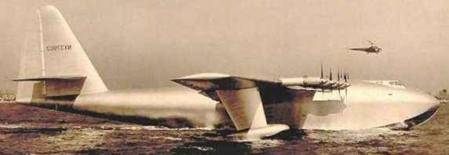

Die Hughes H-4 Hercules ist ein vom Unternehmen Hughes-Kaiser entwickeltes und von Hughes Aircraft Company gebautes Flugboot. Auf die Flügelspannweite bezogen war es das größte jemals geflogene Flugzeug, bis es am 13. April 2019 vom Scaled Composites Stratolaunch abgelöst wurde. Da der einzige Flug der H-4 innerhalb des Bodeneffekts stattfand, ist ihre Flugfähigkeit für darüber hinaus gehende Höhen nicht nachgewiesen.

Henry J. Kaiser, der Hersteller der Liberty-Schiffe, hatte die Vorstellung des Baus einer Flotte von sehr großen Flugbooten, die der Unterstützung des US-amerikanischen Kriegseinsatzes dienen sollten. Er wandte sich an Howard Hughes, den er als Partner gewinnen konnte und der seine Erfahrung im Flugzeugbau einbringen sollte. Zusammen gründeten sie die *Hughes-Kaiser Corporation*, die einige entsprechende Entwürfe der US-amerikanischen Regierung vorlegte und danach im November 1942 einen Auftrag über 18 Mio. US-Dollar zum Bau von drei großen Flugbooten mit der Bezeichnung *HK-1* (Hughes-Kaiser 1) erhielt. Eine wesentliche Auflage des Vertrags war die Verwendung von „nicht kriegswichtigen Werkstoffen“ und Arbeitskräften. Somit war nur die Holzbauweise möglich, wobei man hier jedoch Neuland betrat, da vorher niemals ein solch großes Flugzeug aus diesem Werkstoff gebaut worden war. Deswegen erhielt das Flugzeug auch den Spitznamen. Tatsächlich wurde aber hauptsächlich laminiertes Birkenholz in der Form von *Duramold* verwendet. Dieses Verfahren erlaubte die Herstellung von doppelt gekrümmten Flächen mittels Phenol-Formaldehydharz-getränktem Sperrholz, das mit hohem Druck und bei hoher Temperatur in die entsprechende Form gepresst wurde.

Für Kaiser wurde bald erkennbar, dass seine Erfahrungen und Einrichtungen für den Bau von Schiffen nur von geringem Nutzen beim Bau großer Holz-Flugzeuge waren. Er zog sich daraufhin aus dem Projekt zurück. Die nun als H-4 Hercules bezeichnete Maschine wurde in einem großen, aus Holz errichteten Hangar mit den Abmessungen 228 m × 76 m gebaut. Allein für den Brandschutz wurden sechs Mio. US-Dollar ausgegeben. Im März 1944 war zwar die Fertigstellung noch in weiter Ferne, die vorgesehenen 18 Mio. US-Dollar aber bereits aufgebraucht, so dass der ursprüngliche Vertrag auf ein Flugzeug reduziert wurde. Auch bei Kriegsende war der Bau noch nicht beendet, und Hughes musste sieben Mio. US-Dollar aus privaten Mitteln aufwenden, um die Maschine im Juni 1946 fertigstellen zu können.

Eine weitere Herausforderung war der Transport der H-4 über die 28-Meilen-Strecke von Culver City nach Terminal Island (Long Beach), der alleine 55.000 US-Dollar kostete. Die größten transportierten Teilstücke waren dabei die beiden 48,8 m langen Tragflächenteile.

Am 1. November 1947 wurde die Spruce Goose (Luftfahrzeugkennzeichen NX 37602) zu Wasser gelassen und erste Rollversuche unternommen. Man schleppte sie am 2. November 1947 ins offene Wasser und Hughes absolvierte mit Journalisten aus aller Welt an Bord zwei schnelle Wasserfahrten; bei einem dritten Versuch um 13:40 Uhr hob das Flugboot zum ersten und einzigen Mal ab zu einem Flug von 1,5 km Länge in 20 m Höhe mit einer Geschwindigkeit von etwa 160 km/h. Dabei blieb das Flugzeug stets im Bereich des erhöhten Auftriebs gebenden Bodeneffekts. Seine Flugtauglichkeit außerhalb des Bodeneffekts ist daher nicht nachgewiesen. Die Werte für Flächenbelastung und Leistungsbelastung liegen bei voller Zuladung teilweise unter denen der einigermaßen vergleichbaren Martin „Mars“, die dieselben Motoren verwendete; daher scheinen die errechneten Werte für die Flugleistungen realistisch.

Anschließend wurde das Flugschiff in einem klimatisierten Hangar in Long Beach eingemottet, wobei es nach Hughes’ Anweisung in flugfähigem Zustand gehalten wurde und man sogar die Motoren jeden Monat einmal warmlaufen ließ. Erst nach dem Tod von Hughes konnte das Flugschiff der Öffentlichkeit zugänglich gemacht werden. Hierfür wurde ein gigantischer Rundkuppelhangar gebaut. Von 1981 bis 1992 diente die H-4 Hercules im Hafen von Long Beach zusammen mit dem großen Transatlantikliner *RMS Queen Mary* als Ausstellungsstück. Seit 1992 steht das Flugboot im Evergreen Aviation Museum in Mc Minnville, Oregon.

Bis 2017 hatte dieses Flugschiff die größte Flügelspannweite sowie die größte Flügelfläche aller bisher gebauten Luftfahrzeuge. Die Spruce Goose war das erste Flugzeug mit vollständig hydraulisch angetriebenen Steuerflächen.

**Kenngrößen, Daten *(die Leistungsdaten sind Rechenwerte):***

Besatzung 18

Passagiere bis zu 750

Länge 66,74 m

Spannweite 97,51 m

Höhe 25,15 m

Flügelfläche 1061,80 m²

Flügelstreckung 9,0

Leermasse ca. 122.500 kg

Startmasse ca. 181.500 kg

Flächenbelastung 124 kg/m² mit 10 t Zuladung – 170 kg/m² mit voller Zuladung*

Antrieb acht 28-Zylinder-Mehrfachsternmotoren Pratt & Whitney R-4360-4A\
mit je 2240 kW (3040 PS)

Leistungsbelastung 5,45 kg/PS bei 10 t Zuladung, 7,94 kg/PS bei voller Zuladung *

Propeller Vierblatt-Verstell-Propeller Hamilton Standard mit 5,23 m Durchmesser

(Geplante) Höchstgeschwindigkeit 378 km/h in Meereshöhe

(Geplante) Reisegeschwindigkeit 320 km/h

(Geplante) Dienstgipfelhöhe 6370 m

(Geplante) Reichweite 4827 km

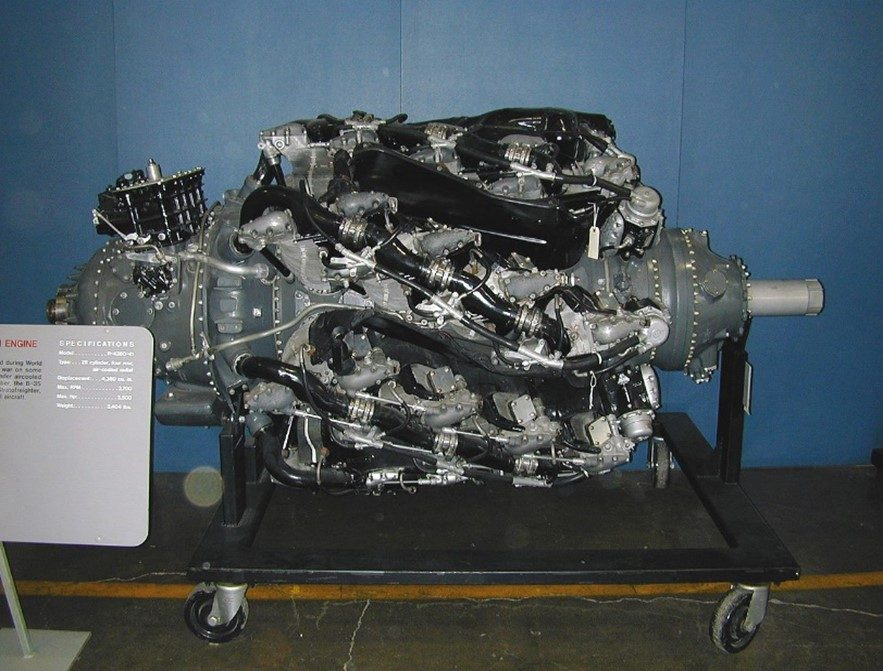

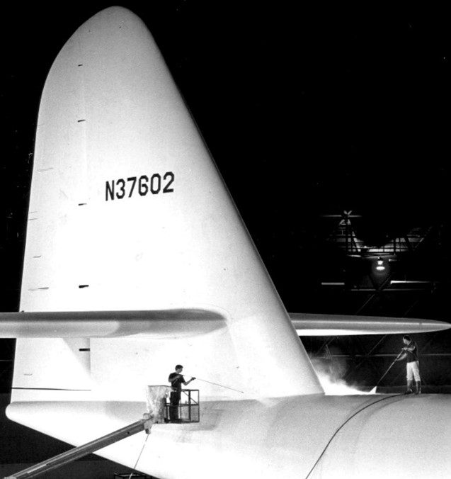

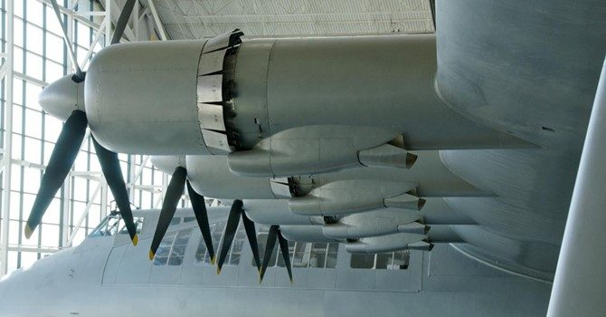

**Nun aber zum Modell**

Welche Frage gilt es zuerst zu klären?

Logisch- wie groß darf das Modell werden damit es noch in den aktuellen PKW passt?

Am Ende der Überlegungen stand ein dreiteiliger Flügel mit 2.5 m Spannweite, 1,4 m Mittelteil mit den acht Motoren und zwei 0,55 m Ansteckenden mit den Querrudern und den Stützschwimmern.

Der Rumpf ist einteilig, das Seiten- und Höhenleitwerk als komplettes Bauteil abnehmbar.

Welche Bauart bietet sich an, wenn man möglichst leicht aber dennoch stabil bauen möchte?

Erste Überlegungen weitestgehend mit Depron-Platten zu bauen, um unter der 5 Kg-Grenze zu bleiben wurden spätestens dann verworfen als ich in Youtube die Filme von solchen Exemplaren gesehen habe und wie die weichen Flügel bei jeder Turbulenz auf und ab schwingen. Das entspricht nicht meinem Anspruch an eine gewisse Vorbildtreue.

Also wurde folgende Auswahl getroffen:

Tragflächen in konventioneller Styropor / Abachi – Bauweise, Oratex-Bügelfolie,

Leitwerke aus 20 mm Hartschaumplatten, profiliert, mit 80 Gramm GFK beschichtet,

Rumpf inneres Gerüst aus Depron mit 2 mm Balsa und 80 Gramm GFK beschichtet.

Als Antrieb wurden acht Koptermotore 2204, 2300 KV mit 6x4 Kohleprops an zweimal 5000 mA- Lipos 3S vorgesehen. Prüfstandmessungen ergaben bei 15 A max. einen Standschub von 500-530 Gramm je Motor.

**Zuerst wurden die Tragflächen gebaut.**

Die Profilwahl fiel auf das NACA 4415, ein tragendes Profil mit 15 % Dicke für langsame Modelle – ähnlich dem Clark Y. Das Original hatte ein sehr dickes, halbsymetrisches verwölbtes Profil. Das 4415 wird auf dem ganzen Flügel verwendet, Tiefe innen 405 mm, außen 170 mm. Die beiden Außenflügel sind auf Ihre Länge von 550 mm um plus 2,5 ° geschränkt, sie sind mit einer 12x1mm Kohlerohr-Steckung mit dem Innenflügel verbunden. Mangels genauer Angaben wurde anhand von Fotos und 3-Seiten-Ansichten eine V-Form von 66 mm je Seite ermittelt und bei der Verbindung der beiden Mittelteile berücksichtigt.

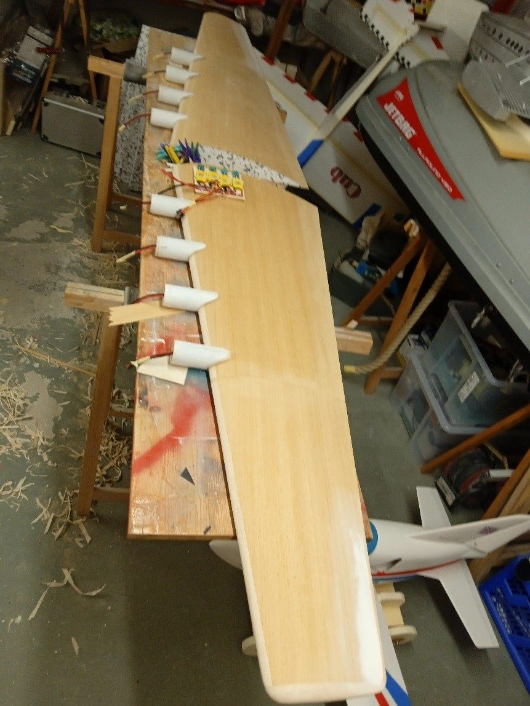

Das Flügel-Mittelteil ist hier noch nicht miteinander verbunden.

In dieser Phase wurden die Motorkabel eingezogen, je 3 Stück pro Motor da die Regler nicht in den Motorgondeln platziert werden, sondern im vorderen Rumpf um die Verbindung zwischen Akku und Regler möglichst kurz zu halten.

Das ergibt zwar für jeden Antrieb drei anstatt zwei Kabel und eine grüne Multiplex-Steckverbindung, erspart aber acht Kondensatorbänke wegen der ansonsten sehr langen Stromversorgungskabel.

Die Motorgondeln sind aus 2 Lagen GFK laminiert, mit einem 10 mm dicken Motorspant aus Pappelsperrholz verschlossen und stumpf an die Flügelkontur mit angedicktem Epoxidharz angeleimt.

Die Außenflügel sind auf ganzer Länge mit Querrudern versehen und nehmen die Stützschwimmer – welche aus Hartschaumplatten „aus dem Vollen geschnitzt“ und mit 80 Gramm GFK belegt wurden – mittels einer 6 mm Kohlerohr-Steckung auf.

Auf Landeklappen oder Bremsklappen am Innenflügel wurde wegen der zu erwartenden niedrigen Grundgeschwindigkeit des Modells verzichtet.

Alle Tragflächenteile sind aus 80 mm Styropor-Platten geschnitten und mit 1 mm Abachi-Fournier und Epoxidharz beplankt, Nasenleiste und Randbogen aus 12 mm Balsa.

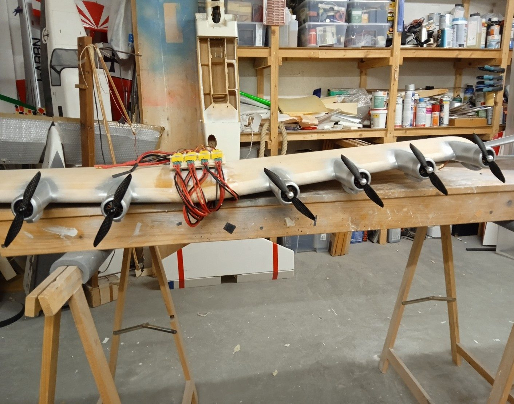

Hier durften die Antriebe zum ersten Mal ihren Arbeitsplatz einnehmen und einen kurzen Probelauf im unteren Drehzahlbereich absolvieren, Vollgas geht im Keller nicht – da sind die Regale leergefegt.

Vier links, vier rechts ist kein Strickmuster, sondern die Laufrichtung der Antriebe die über Zuschaltung der Seitenruderfunktion das Manövrieren auf dem Wasser erlauben, ein Wasserruder hat auch das Original nicht.

Die Motorverkleidungen sind wie die Gondeln aus 2 Lagen GFK, die Attrappen der Ölkühler aus Hartschaum geschnitzt.

**Nächste Baustufe war das Leitwerk.**

Es besteht wie erwähnt komplett aus 20 mm Hartschaum-Platten, die auf ein symmetrisches Profil geschliffen wurden, ohne jegliche Holme oder andere Verstärkungen. Die Festigkeit und Stabilität erhält das Ganze lediglich über die GFK-Oberfläche.

Die Verbindung zum Rumpf übernimmt ein 12x1 mm Kohlerohr dass im Seitenleitwerk verankert ist. Das Seitenleitwerk ist mit dem Höhenleitwerk fest verbunden, beides als Einheit wird in dem auf dem Bild noch weiß grundierten Unterteil fixiert und befestigt. Das Unterteil wird später fest im Rumpf eingebaut.

Alle Ruderflächen sind mit KAVAN-Scharnieren angeschlagen. Diese sind beidseitig mit Ponal-Express in Schlitze im Hartschaum geleimt. Dies mag manchem erfahrenen Modellflieger sehr gewagt vorkommen.

Allerdings ist dies nicht das erste Modell in dieser Ausführung und es hat trotz mitunter rauen Anforderungen nie versagt. Wichtig ist, dass die Schlitze und die Löcher in den Scharnieren sorgfältig mit Ponal-Express ausgefüllt werden, dieser schrumpft beim Austrocknen unerheblich. Wichtig ist, dass bis zur Erstbelastung ausreichend Trocknungszeit vergeht. Ich gehe davon mindestens 4 Wochen aus da aus dem Hartschaum praktisch keine Feuchtigkeit entweichen kann. Ein Versuch nach 4 Wochen ein Scharnier im Schraubstock eingespannt mittels Hebeln aus dem Block zu reißen führte lediglich zur Zerstörung des Versuchsblocks bis zur Freilegung der Klebstelle um das Scharnier – die Klebermasse war 100% ausgehärtet. Die 4 Wochen dauert in der Regel eh das weitere Finish des Modells.

Im Leitwerk sind 3 Stück 11 mm-Servos mit 4,0 kgcm verbaut, die elektrische Verbindung ist mit den grünen Multiplex-Steckern realisiert.

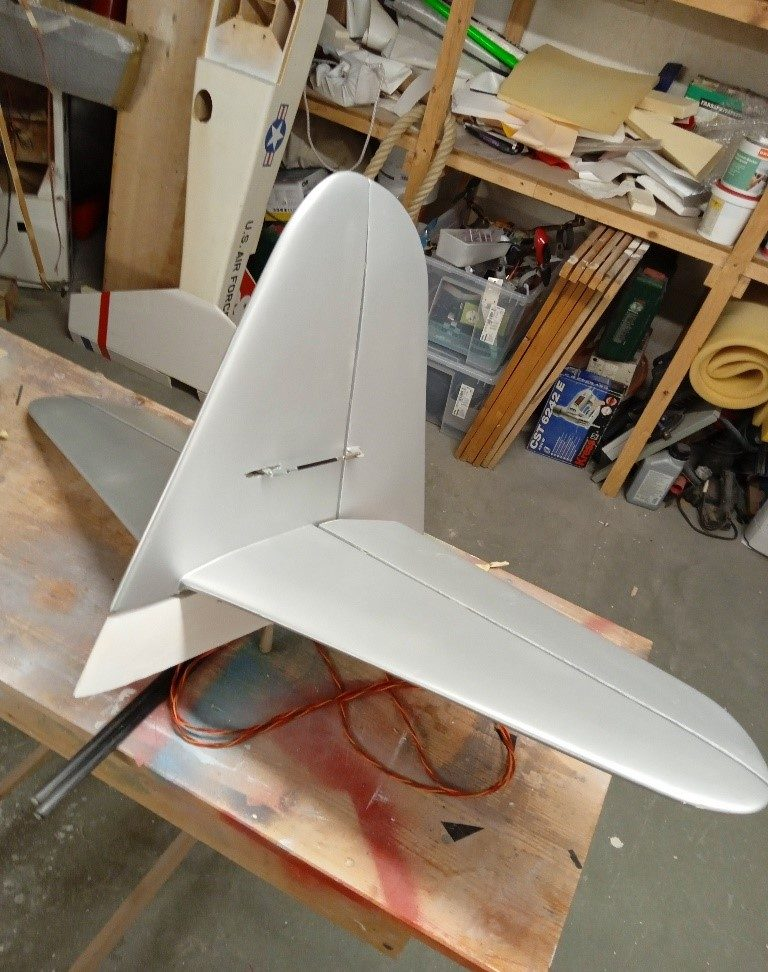

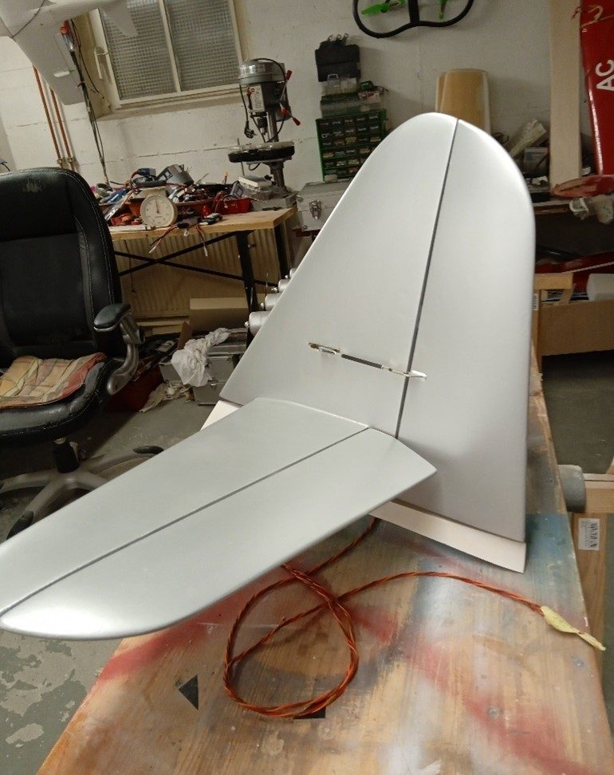

**Kommen wir also zum Aufbau des Rumpfes.**

Zunächst musste eine Möglichkeit zum konstruktiven Aufbau des Rumpfes gefunden werden.

Dieser ähnelt in seiner Form einer steinzeitlichen Keule alla Fred Feuerstein. Er weist über die Länge sich verändernde Querschnitte auf, welche von kreisrund am Heck über oval bis tunnelförmig im vorderen Bereich gehen. Deshalb musste zuerst eine 2-Seiten-Ansicht im 1:1 Maßstab gezeichnet werden aus der dann im Abstand von ca. 120 mm die einzelnen Querschnitte zeichnerisch erzeugt wurden.

Nun war erkennbar, wie ein Aufbau aussehen müsste. Ich entschied mich dafür einen kastenförmigen Innenrumpf aus 9 mm Depron zu erstellen. Dieser geschlossene Kasten ist verdreh – und verwindungssteif und erlaubt dadurch einen einfachen Aufbau der äußeren Kontur. Dies erfolgte dann indem für jeden ermittelten Querschnitt (Spant) jeweils 3 bzw. 4 Teilspanten auf den Kasten aufgeklebt wurden. Im vorderen, unteren Bereich, d.h. der Kiel bis zur Stufe und hinter der Stufe wurde aus 30 mm Hartschaumplatte aus dem Vollen herausgeschliffen und als unterer Abschluss an den Rumpfkasten geklebt. In diesem Bereich sind eben nur 3 Teilspanten erforderlich. Alle Klebungen wurden mit UHU-Por ausgeführt. Im Heck wurde dann das oben beschriebene Unterteil des Leitwerks integriert. Im vorderen Rumpfteil wurde ein Akkuschacht eingebaut, der bis zur Vorderkante der Tragfläche reicht, damit wird eine zusätzliche Rumpföffnung zum Akkuwechsel vermieden, dies stellt sich später nach der Fertigstellung als gute Entscheidung heraus – ist doch die Partie der Pilotenkanzel nicht durch solche Kompromisse verschandelt und hat eine homogene Oberfläche.

Der so weit fertiggestellte Innenrumpf wiegt lediglich ca. 300 Gramm.

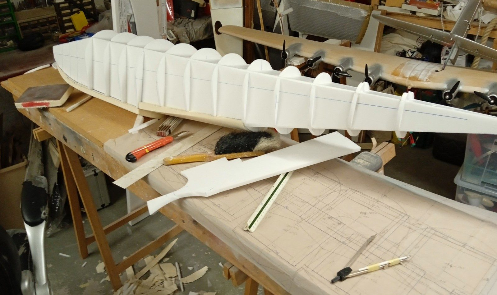

Mittels Schleiflatte wurden anschließend die Spanten egalisiert, sodass eine saubere Linienführung entsteht. Danach wird dieses Bauteil sektionsweise mit 2 mm Balsa beplankt. Wegen der teilweise sehr engen Radien ist das Wässern den Beplankungsteile und Fixieren mit Klebeband bis zum Trocknen   (ca.24 Std.) erforderlich. Das Aufbringen der Beplankung erfolgt dann mit Ponal-Express, der nächste Beplankungsabschnitt kann dabei gleichzeitig vorgefertigt, gewässert und fixiert werden. Das Trocknen von Verklebung und nächstem Abschnitt erfolgt dann zeitgleich.

So ist nach wenigen Tagen ein Rumpfrohling entstanden, der nach dem Verschleifen mit 80 Gramm Glasgewebe laminiert wird. Schon liegt die Fred Feuerstein-Keule auf dem Baubrett!

Was dann folgt ist ebenso faszinierend wie wichtig für das weitere Gelingen des Projekts.

Zunächst erfolgt die erste Hochzeit des Leitwerks mit dem Rumpf, gefolgt von der Kontrolle des geplanten Einstellwinkels von -0,5° bis +- 0,0°.

Danach wird der Rumpf mit Leitwerk in einer provisorischen Helling so fixiert, dass die Rumpfmittelachse (auf dem Foto als durchgehende Linie von der Nase bis zum Rumpfende erkennbar) horizontal im Wasser liegt und nicht verrutschen kann.

Nun wird der Ausschnitt für den Tragflügel eingemessen und beidseitig am Rumpf aufgezeichnet.

Spätestens jetzt muss der Anstellwinkel zwischen Rumpfmittellinie und der Profilsehne endgültig festgelegt und bei dem Flügelausschnitt berücksichtigt werden. Dazu müssen die Profilpolaren berücksichtigt werden. (Gibt’s als Buch oder im Internet) Bei einer angenommenen mittleren Fluggeschwindigkeit von 40 – 50 km/h (11,1 – 13,8 m/s) ergibt sich eine Re-Zahl von ca. 223 000 – 277 000. Nach den Polardiagrammen stellen sich damit vernünftige Beiwerte für Widerstand und Auftrieb bei einem Anstellwinkel von 3,2°-3,5° ein. Die Profilsehne verläuft als gerade Linie durch Profilende und Mitte Nasenradius und bildet beim NACA 4415 zu dessen gerader Unterseite bereits einen Winkel von 2,2°. In logischer Folge wurde der Anstellwinkel bezogen auf die Profilunterseite um weitere 1,0° auf 3,2° erhöht und der Flügelausschnitt so angezeichnet und herausgearbeitet. Dabei muss beachtet werden, dass das ausgetrennte Teil nicht beschädigt wird da später daraus der vordere und der hintere Übergang Flügel/Rumpf hergestellt werden muss.

Mit dem Einpassen des Flügels, Einbau der erforderlichen Spanten und Verstärkungen im Bereich des Ausschnittes sowie die Aufnahme der Flügelbefestigung geht es weiter. Der durch den Ausschnitt entstehende Zwischenraum zwischen dem inneren Depronkasten und der Balsa-Beplankung wird im Bereich der ganzen Flügelauflage mit 2 mm Balsa beplankt. Der gesamte Rumpf weist durch die quasi-doppelwandige Ausführung eine enorme Festigkeit auf, die äußere GFK-Auflage schützt vor Beschädigung.

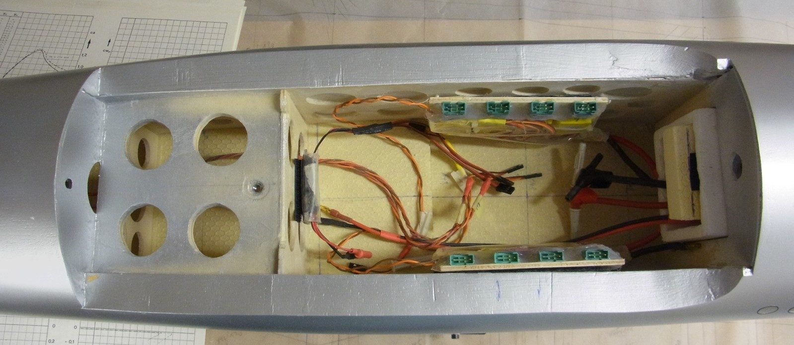

Die eingebauten Verstärkungen des Flächenausschnitts aus 4 mm Pappelsperrholz

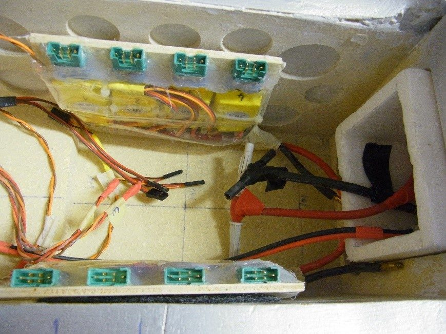

Die beiden Panels mit je 4 x 30 A-Reglern und den Steckverbindungen zu den Motoren.

Rechts der Akkuschacht der die beiden 5000er Dreizeller -zur Motorstromversorgung und einen 3000er Zweizeller zur Empfängerstromversorgung aufnimmt.

Die endgültige Gewichtsbilanz nach Einstellung Schwerpunkt mit zusätzlich Blei in der Schnauze liegt bei 6,0 Kg, flugfertig mit allen Akkus. Der Flügel wiegt komplett 1,8 Kg, davon ca. 650-700 Gramm Kabel.

Die Flächenbelastung stellt sich damit bei 82 g/dm2ein. Ich glaube, dass damit ein dem Vorbild gut entsprechendes Modell entstanden ist das auch in seinem Flugverhalten diesem Anspruch genügen wird.

Bleibt nur noch auf das für einen Erstflug akzeptable Wetter zu warten, ich hoffe dann den Einen oder Anderen am Platz zu treffen. (Ja der Erstflug wird von festem Boden aus gestartet werden.)

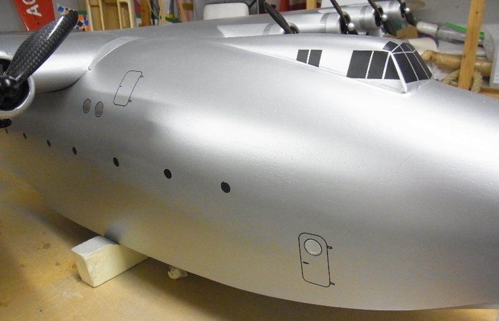

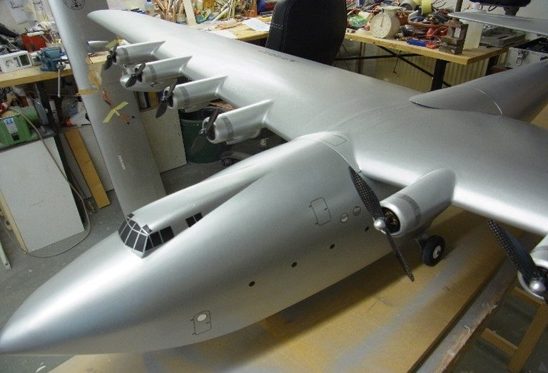

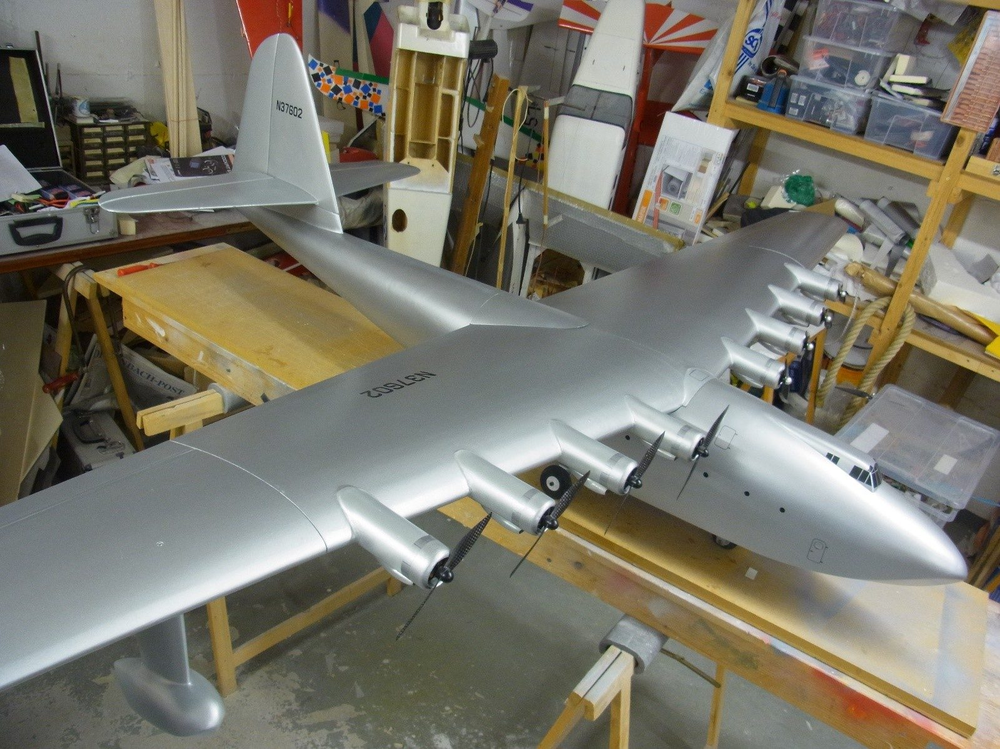

PS: Das Original hatte außer den Kennungen keine weiteren Decals, diese wurden wie auch die Folien für die Türen und Bullaugen wieder von Stephan angefertigt-nochmals Danke.

Mittlerweile erfolgten die ersten Flüge.

Das mit Klettband an der Rumpfunterseite fixierte – eigentlich als Provisorium gedachte – ungesteuerte Fahrwerk hat sich dabei bestens bewährt.

Die Einstellungen von Schwerpunkt und Einstellwinkeln haben sich als vollkommen richtig erwiesen. Beim Erstflug musste lediglich das Höhenruder zwei Zacken negativ getrimmt werden, alle anderen Steuerfunktionen hatten gestimmt.

Die Vollgasleistung der acht Motore kommt lediglich beim Start zum Einsatz, der Gegenanflug erfolgt bereits mit Halbgas, das Cruisen mit Viertel- bis Halbgas steht dem Flugbild dieses Modells am besten.

Bleibt nur noch auf baldiges Erproben auf dem Wasser zu hoffen was aber bei dem bisher sehr gutmütigen Flugverhalten keine Probleme erwarten lässt.
