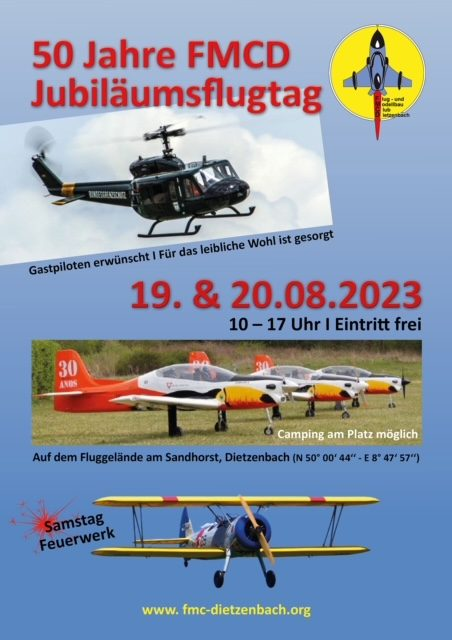
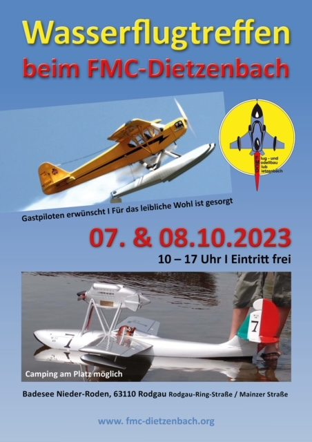

**Veranstaltungen des FMCD**

*15. und 16.April 2023 jeweils von 10:00 bis 17:00 Uhr*

Workshop Wasserfliegen am Badesee Niederroden

*06. und 07. Mai 2023*

Ausstellung im Rathauscenter Dietzenbach

*06. bis 11. Juni 2023*

Fliegerzeltlager Wasserkuppe

Interessenten melden sich unter: derpraesi@vodafon.de

*19. und 20. August 2023*

Jubiläumsflugtag am Flugplatz Sandhorst

**50 jähriger Jubiläumsflugtag des Flug u. Modellbauclub Dietzenbach**

Mit 2-jähriger Verspätung findet in diesem Jahr endlich unser Jubiläumsflugtag statt.

Am 19. u. 20. August 2023 werden Vereinseigene und natürlich auch Gastpiloten auf unserem Fluggelände ihr Können zeigen. Vom kleinen Segler über Motormodelle und Jets bis hin zum Scalehubschrauber wird alles am Start sein.

Samstags steht freies Fliegen auf dem Programm, bei dem die Piloten die Möglichkeit haben sich an das Fluggelände zu gewöhnen. Bis zum Einsetzen der Dämmerung steht unser Flugplatz für Trainingsflüge zur Verfügung. Abends wird dann der Tag mit einem Feuerwerk ausklingen.

Sonntagmorgen ab 10Uhr geht es dann zum offiziellen Programm über.

Ein Frühschoppen bis ca. 13 Uhr läutet den Tag ein, der dann nahtlos zum geregelten und kommentierten Fliegen über geht.

Für Zuschauer wird es viele spektakuläre Modelle und Flüge zu sehen geben.

Essen vom Grill und von der Kuchentheke wird natürlich ausreichend vorhanden sein.

Um unser Fluggelände vorher kennen zu lernen, sind Gastpiloten natürlich das ganze Jahr über willkommen. wolfgang.ruppert@icloud.com

*07. und 08. Oktober 2023*

Wasserflugmeeting am Badesee Niederroden

Wasserflugtreffen des Flug und Modellbau Club Dietzenbach

07.-08. Oktober findet wie in jedem Jahr wieder unser beliebtes Wasserfliegen statt.

Viele von Euch kennen es ja schon. Dazu gibt es nicht viel zu sagen.

Bringt einfach mit, (egal ob Elektro oder Verbrenner) was auf dem Wasser starten und landen kann, gute Laune und Hunger. Dann habt ihr 2 Tage Spaß.

Beide Tage ist freies Fliegen von 10-17 Uhr am Badesee in Rodgau Nieder-Roden.

Camping am Platz ist möglich.

Näheres erfahrt Ihr auch übers Jahr auf unserer neu überarbeiteten Homepage.

www.fmc-dietzenbach.org

====================================================================

**Veranstaltungen befreundeter Vereine**

*06. und 07. Mai 2023*

Flugtag des MFSG Albatros e.V. Großkrotzenburg

*03. Juni 2023*

Freundschaftsfliegen beim MFC Langen ab 10:00 Uhr *www.mfc-langen.de*

*10. und 11. Juni 2023*

Flugplatzkerb  in Gelnhausen

*16, und 17. September 2023*

Wasserflugtreffen MFG Markdorf, Strandbad Hagnau

www. Wasserflug@Modellfluggruppe-Markdorf.de
