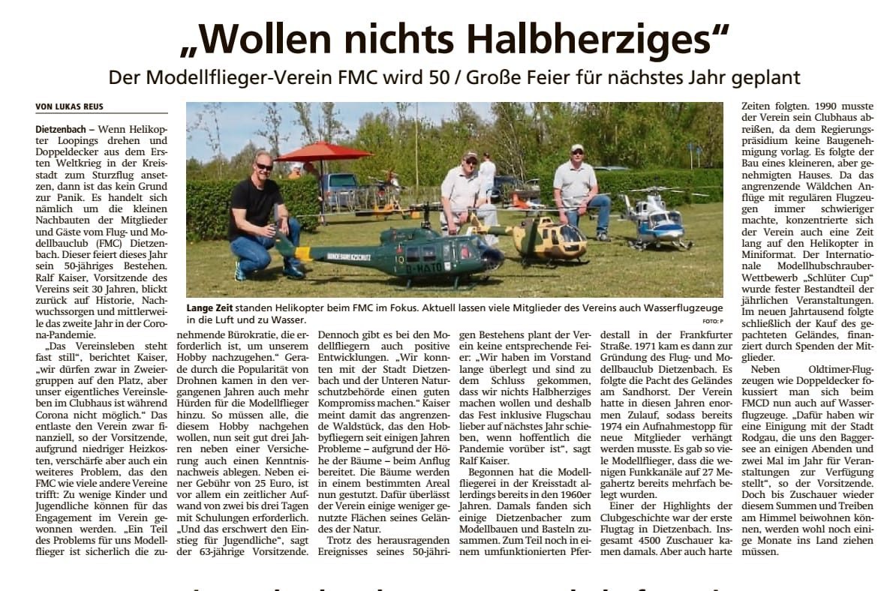
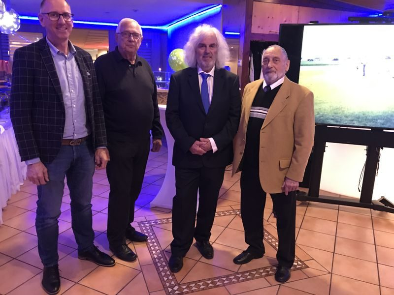

**50-jähriges Jubiläum des Flug-u. Modellbau Club Dietzenbach**

In den 60er Jahren traf sich eine kleine Gruppe Modellflieger an der Russenhütte in Dietzenbach, um ihr damals noch eher seltenes Hobby auszuüben. Der Bastelraum befand sich am Anfang in der alten Schule. Später wurde dafür ein ausgedienter Pferdestall umgebaut. Um das Modellfliegen offiziell und vor allen Dingen für die Jugend zugänglich zu machen, wurde 1971 der Verein „Flug-u. Modellbau Club Dietzenbach“ gegründet.

Gründungsmitglieder waren damals: Otto Wolfert, dessen Sohn Otto und Neffe Erich Wolfert, sowie Klaus Eckert, Ewald Schickedanz, Kurt Wolf und ein Herr Verdum.

Als erster Vorsitzender des Vereins, von 1971-1976, wurde der Dietzenbacher Klaus Eckert gewählt. Durch gute Beziehungen zur Stadtverwaltung wurde schnell ein neues Fluggelände am Sandhorst gefunden. Ebenso bekam man die Erlaubnis ein Clubhaus zu bauen. Zusätzlich stellte die Stadt Dietzenbach dem Verein einen neuen Bastelraum zur Verfügung.

Der erste Flugtag fand 1975 statt. Damals machten sich noch bis zu 4500 flugbegeisterte Zuschauer auf den Weg zum Fluggelände.

Der Verein wuchs auf 248 Mitglieder. Davon waren ca. 50-60 Jugendliche.

Die erste Veranstaltung 1978, die sich über mehrere Jahre etablierte, war ein Kuriositätenwettbewerb. Bis zum heutigen Zeitpunkt reihten sich zahlreiche Wettbewerbe und Treffen, wie der über Landesgrenzen hinaus bekannte „Schlüter Heli Cup“, dass „RC-Helitreffen“, der „Heli Newcomer Cup“, dass „Doppeldecker u. Oldtimer Fliegen“ und das bis heute noch stattfindende Wasserflugtreffen aneinander.

Ende 1989 wurde ein neues Clubhaus gebaut, dass bis heute unseren Mittglieder auch die Möglichkeit gibt sich bei schlechtem Wetter zu treffen.

1991 übernahm Ralf Kaiser das Ruder des Vereins. Mit ihm und einem Teil des heutigen Vorstandes ist es gelungen, durch zähe Verhandlungen mit der Stadt Dietzenbach, dass Fluggelände 2002 zu kaufen. Durch strenges Haushalten und großzügigen Spenden einiger Mitglieder, konnten die ersten Raten ohne Kredit bezahlt werden.

2008 wurde der letzte noch ausstehende Betrag beglichen und der Verein war wieder fast schuldenfrei.

Heute präsentiert sich der Verein mit 150 Mitgliedern, einem gepflegten Fluggelände mit gemütlicher Hütte und freut sich nach Corona auf viele kommende Flugtage mit Gastpiloten und Zuschauer.

Selbstverständlich gibt es nach der Pandemie wieder eine Neuauflage des „Doppeldecker u. Oldtimer Fliegen“, sowie des „Wasserflugtreffen“.

Außerdem werden wir dann auch unser Jubiläum auf unserem Platz nachfeiern zu dem wir euch alle, sei es als Piloten oder Zuschauer einladen werden.

Neuigkeiten dazu findet Ihr immer auf unserer Homepage [www.fmc-dietzenbach.org](/).

Wolfgang Ruppert

**Jubiläumsfeier des Flug u. Modellbau Vereins Dietzenbach**

Der Vorstand des FMC-Dietzenbach, allen voran der 1. Vorsitzende Ralf Kaiser, luden ihre Mitglieder am 08.04.2022 anlässlich des 50 jährigen Bestehens, zu einem festlichen Abend im Döbert’s Wirtshaus (Rodgau) ein. Ursprünglicher Termin des Jubiläums war schon 2021. Jedoch mussten jegliche Feierlichkeiten wegen Corona verschoben werden.

Nach einem Sektempfang und einer Willkommensrede seitens Ralf Kaiser, stand ein sehr leckeres Büffet mit ausgesuchten Speisen, für die ca. 70 Gäste bereit.

Zu den Anwesenden gehörten auch die Ehrenmitglieder und Gönner des Vereins, Dieter Laube, Sven Laube und das Gründungsmitglied Klaus Eckert.

Ralf Kaiser moderierte den Abend und erzählte einiges über die Geschichte des Vereins.

Außerdem bedankte er sich bei den Ehrenmitgliedern, dem Gründungsmitglied und dem bestehenden Restvorstand für seine vertrauensvolle Arbeit.

Auch fand er ein paar Worte zum aktuellen Stand des Vereins, der mit eigenem Fluggelände und beheizter Hütte und vor allen Dingen Schuldenfrei, einen sehr soliden Stand aufweist.

Über einen Monitor liefen permanent Bilder und Videos über das Vereinsleben, von der Gründung bis heute, was dem einen oder anderen ein schmunzeln ins Gesicht lockte.

So war es ein gelungener Abend mit viel Gesprächsstoff über Erinnerungen und Ereignisse, einer doch sehr langen Zeit.

Für 2023 ist zusätzlich eine aktive Jubiläumsfeier mit Flugtag auf unserem Fluggelände vorgesehen.

