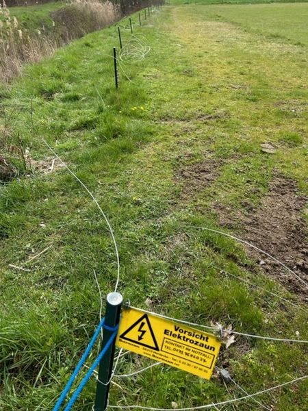

**Vandalismus auf dem Fluggelände des FMC-Dietzenbach\\**In der Woche vor Ostern wurde der Elektrozaun, der das Fluggelände vor Wildschweinen schützen sollte, stark durch Fremdeinwirkung beschädigt.              Mit einem Werkzeug wurden an fast allen Pfosten die Kabel durchtrennt.\
Die Umzäunung hatte der Verein in Eigeninitiative, im Dezember‘22 erstellt. Hundebesitzer und Spaziergänger wurden über einen Artikel in der Offenbachpost darüber informiert.\
Auf die angekündigte Videoüberwachung des Geländes, wollte der Verein eigentlich verzichten, sieht sich jetzt allerdings zu dieser Maßnahme gezwungen.\
Der Vorfall wurde der Polizei gemeldet.\
Zeugen die Beobachtungen gemacht haben, können sich gerne beim Vereinsvorstand melden.

([Vorstand@fmc-dietzenbach.org](mailto:Vorstand@fmc-dietzenbach.org))

