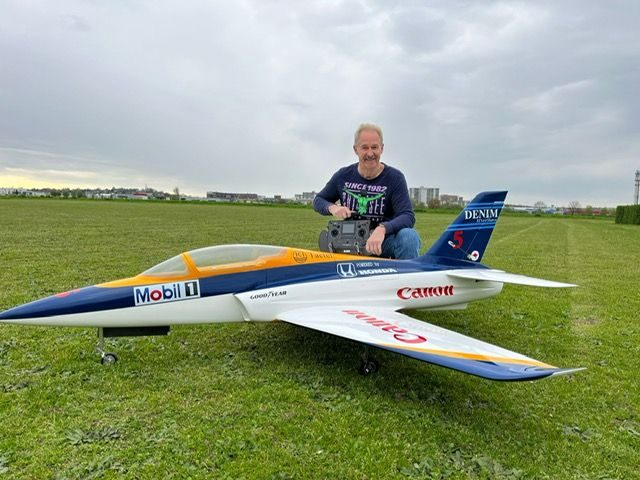
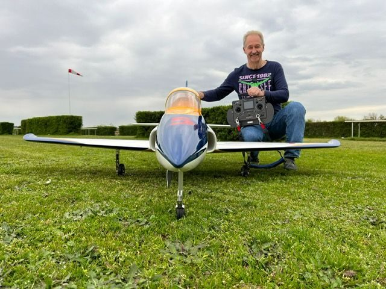
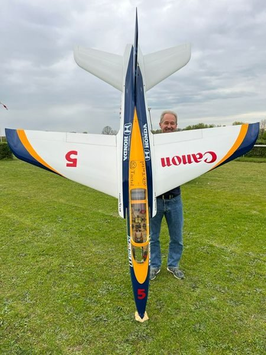
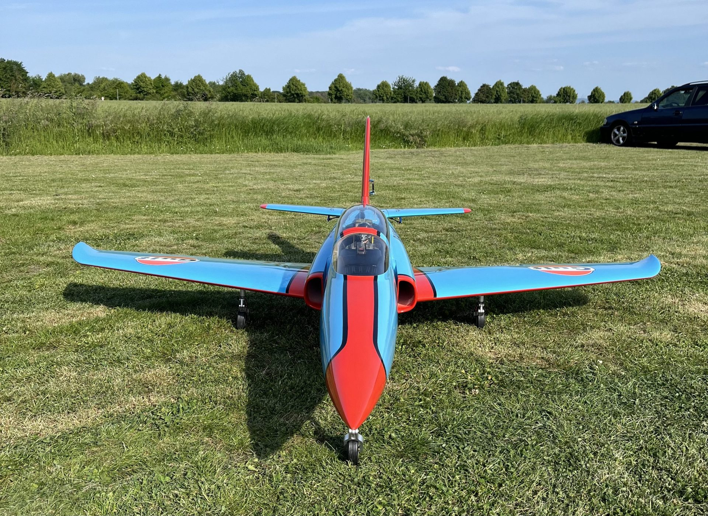
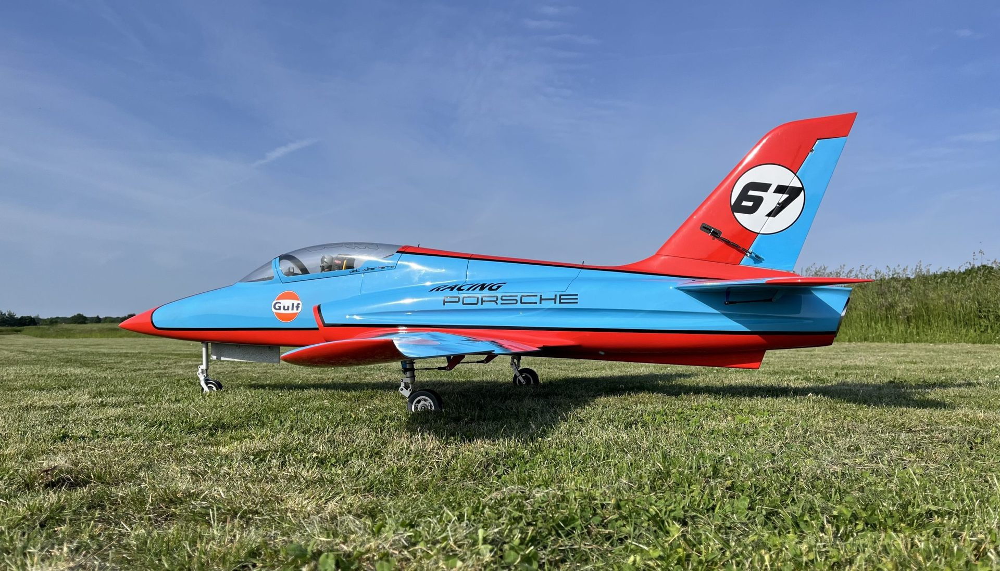
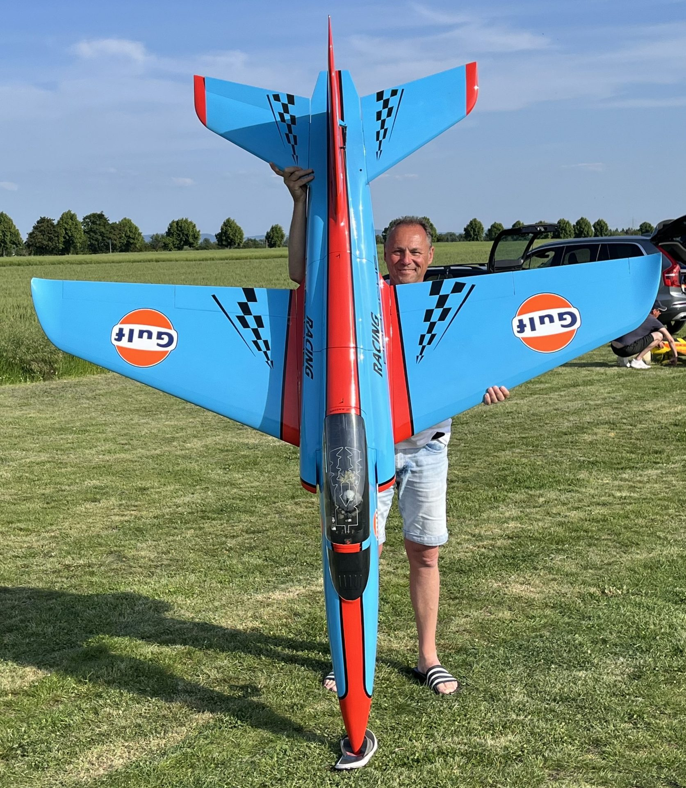

Zum ersten mal die dietzenbacher Luft mit Kerosin geschwängert.

Wolfgang Ruppert und Volker Herre haben ihre neuen Jets vorgestellt, zwei ODYSSEY Turbinenjets hatten am 22. April ihr "Rollout", die beiden Modell haben unterschiedliche Designs.

