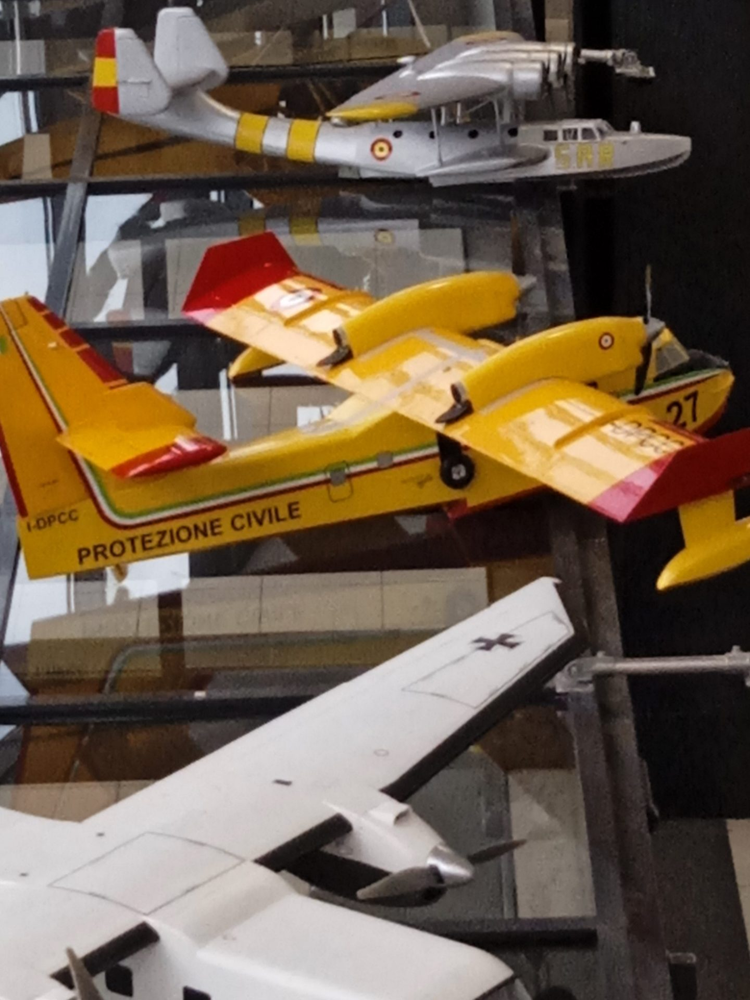
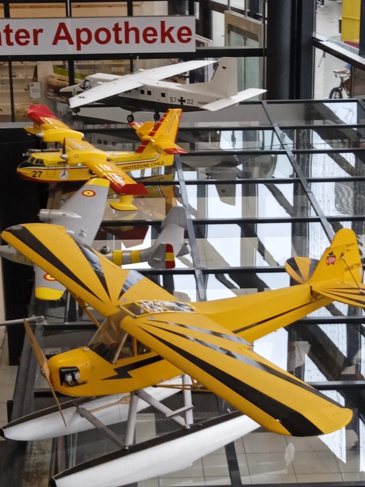
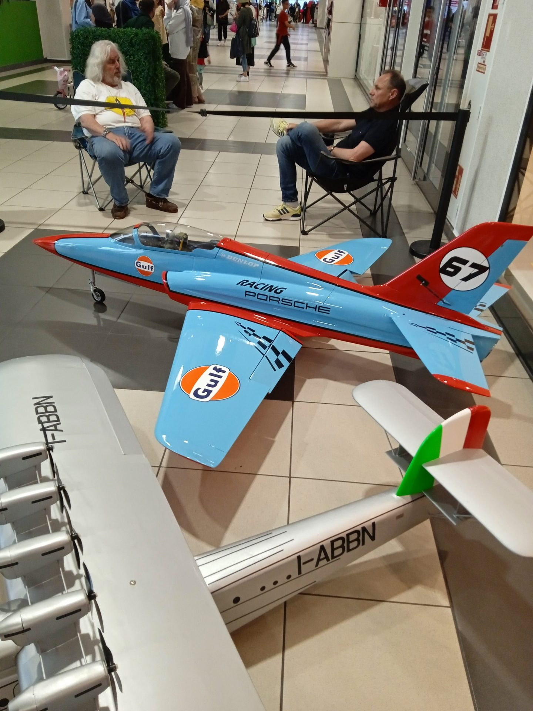
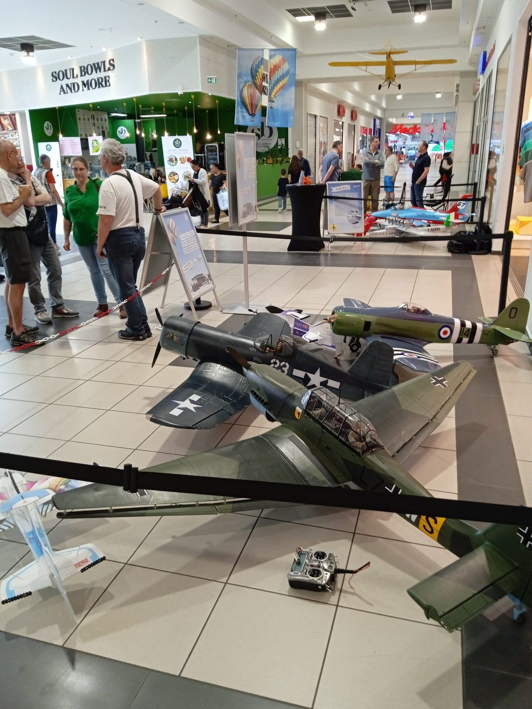
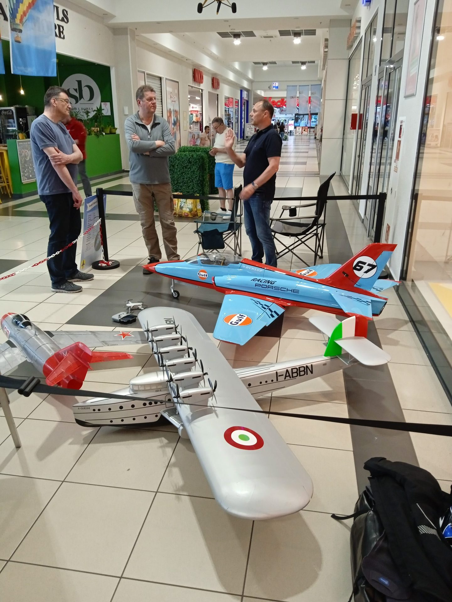
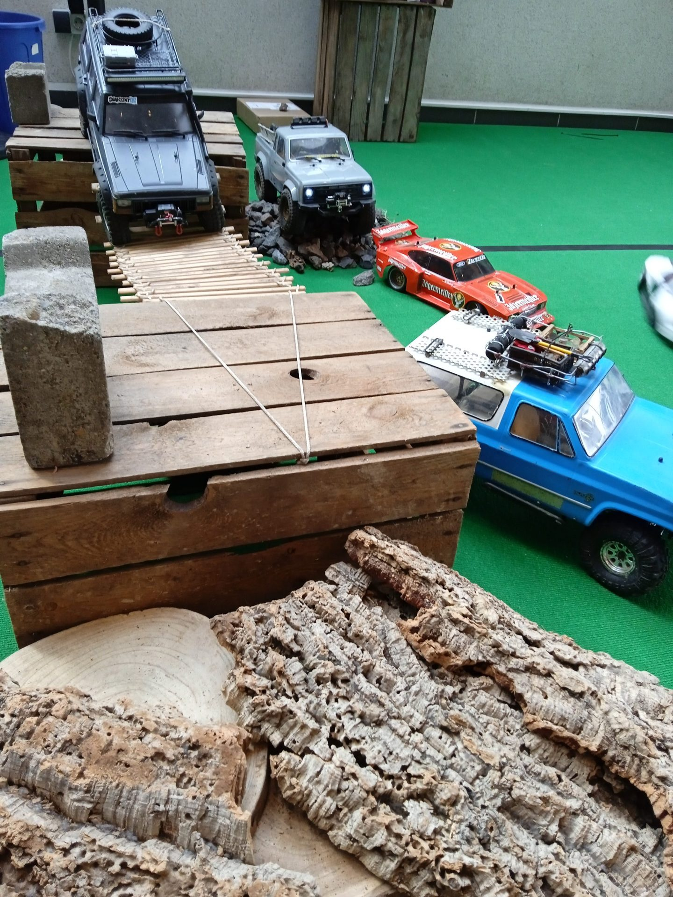
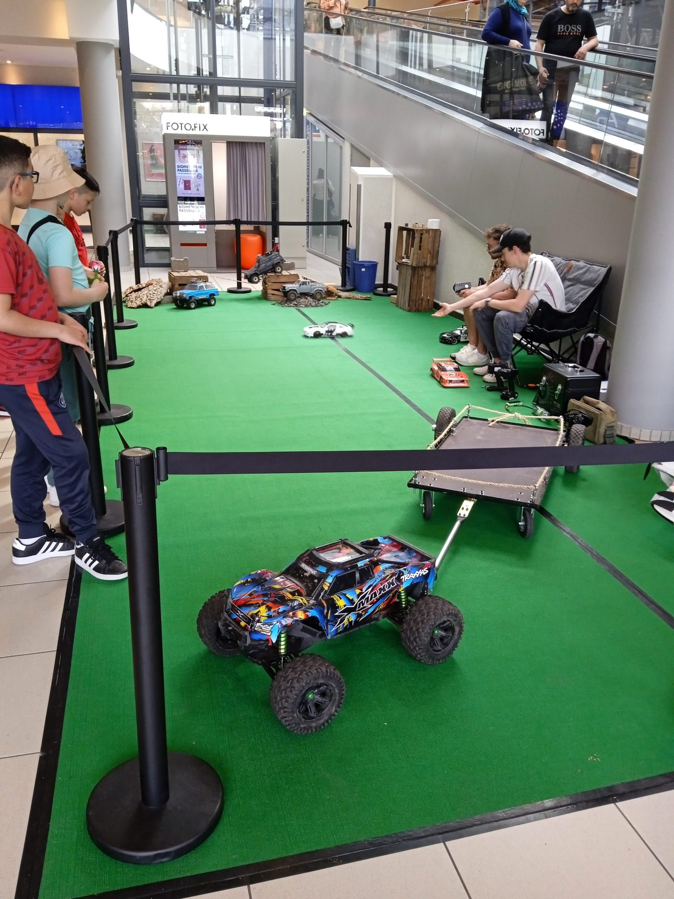
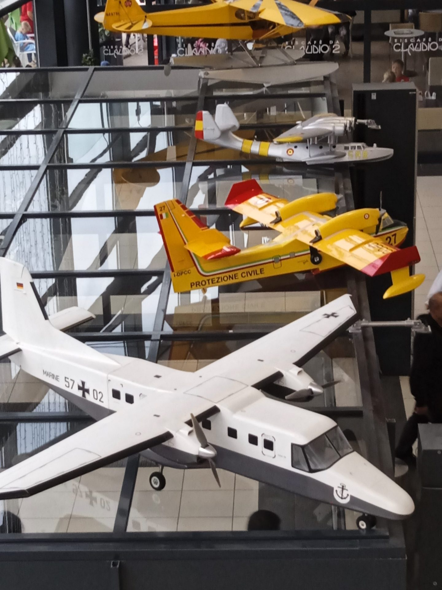

Am 06. und 07. Mai beteiligte sich der FMCD am verkaufsoffenen Wochenende im Dietzenbacher Rathauscenter mit der Ausstellung einiger Modellflugzeuge.                Mehrere aktive Piloten waren ständig vor Ort um die Fragen der Besucher zu beantworten und das eine oder andere Gespräch zu führen. In einem separaten mit Sicherheitsnetz abgetrennten Bereich wurden Indoor-Modelle vorgeführt.

Wer Lust hatte selbst einmal ein Modell zu steuern konnte dies auf unserem nahegelegenen Modellflugplatz im Lehrer-Schüler-Betrieb machen.

Auf einem weiteren Parkour wurden Modellautos beim Driften oder Crawlen vorgeführt.

