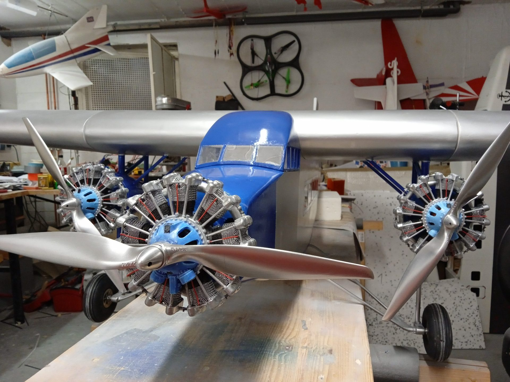
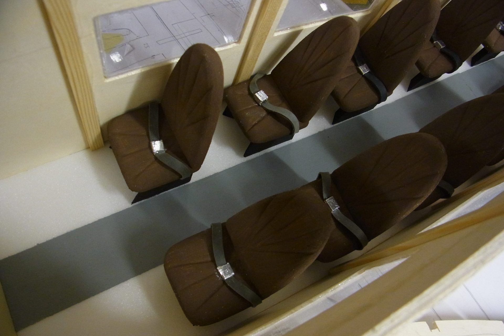
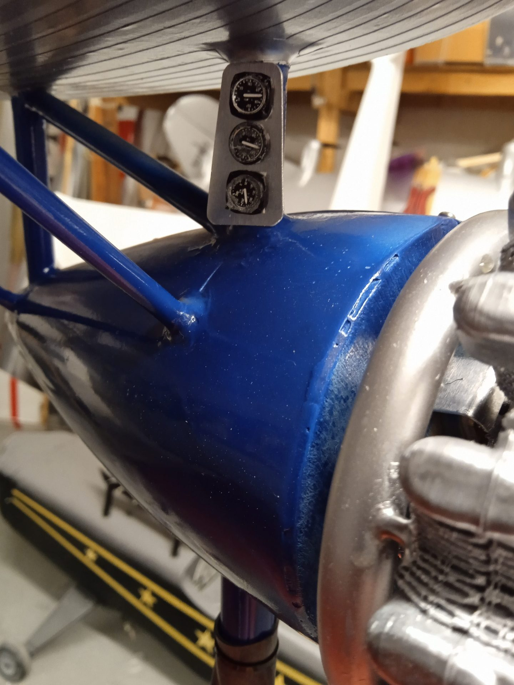
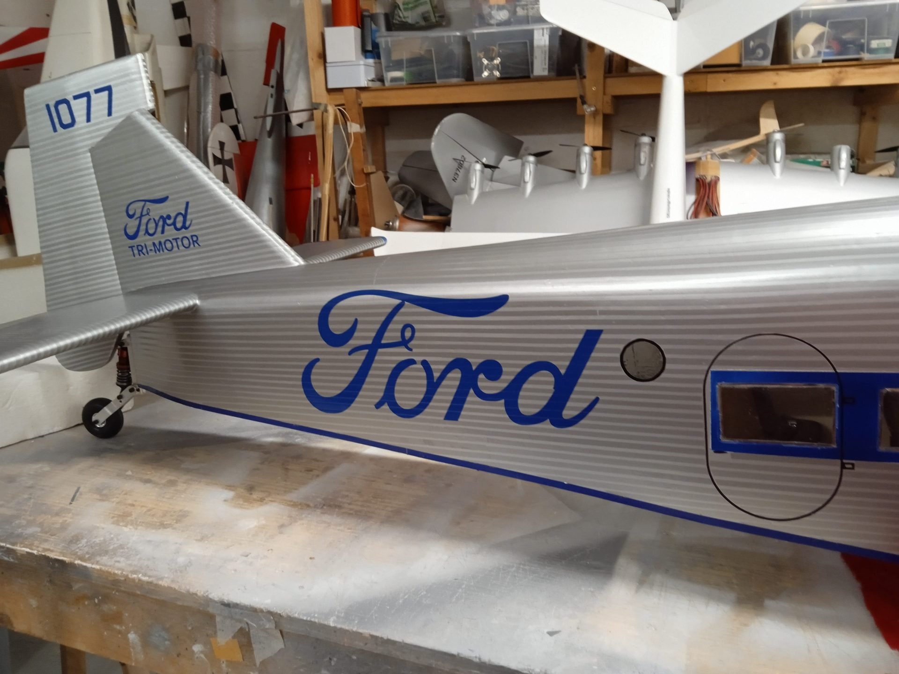
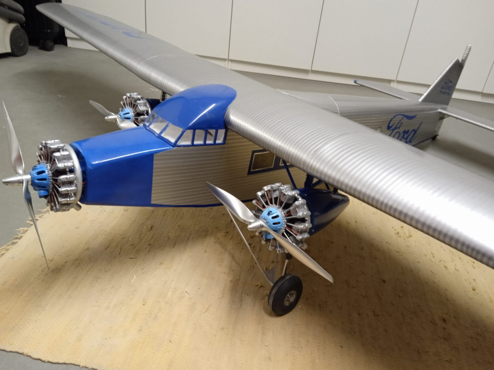

Erste Eindrücke kurz vor Fertigstellung eines neuen Modells.

Die Ford Tri Motor aus den "Goldenen Zwanzigern" wovon noch heute einige liebevoll gepflegte Exemplare in den USA zu Rundflügen starten ist Vorbild meines Ende letzten Jahres begonnenen Nachbaus.

Ein ausführlicher Baubericht wird demnächst folgen.

Rainer Luniak

