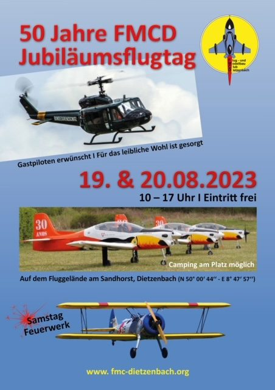

Geplantes Programm:

Samstag den 19.08 (13-14 Uhr Mittagspause hier kann elektrisch geflogen werden)

- Ab 10 Uhr Frühstücks-Büfett am Platz mit Begrüßung der Teilnehmer und beginn der Pilotenanmeldung im Anschluss gegen 10:30 findet das erste Briefing statt.
- Im Anschluss beginnt das freie Fliegen.
- 12 Uhr startet Grillimbiss
- 13 Uhr zweites Briefing der Piloten
- 15 Uhr Eröffnung der Kuchentheke
- 18 Uhr beginn Abendessen
- Ab 19 Uhr Elektroflug bis Sunset
- Highlight ab 21:30 Uhr Profi-Feuerwerk

Sonntag 20.08. (13-15 Uhr Mittagspause hier kann elektrisch geflogen werden)

- Ab 9 Uhr freies Fliegen
- 10:30 Uhr bis 12:00 Uhr Frühschoppen mit offiziellem Teil (Begrüßung der offiziellen Gäste durch den 1. Vorsitzenden)
- 12:15 Uhr erneutes Briefing der anwesenden Piloten nach der Mittagspause Fliegen in koordinierter Flugreihenfolge (die Reihenfolge wird vor Ort festgelegt).
- Ende gegen 17 Uhr
