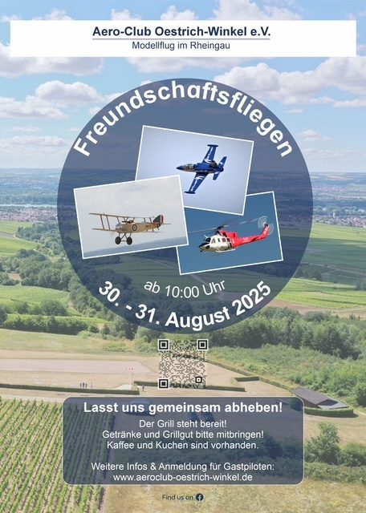
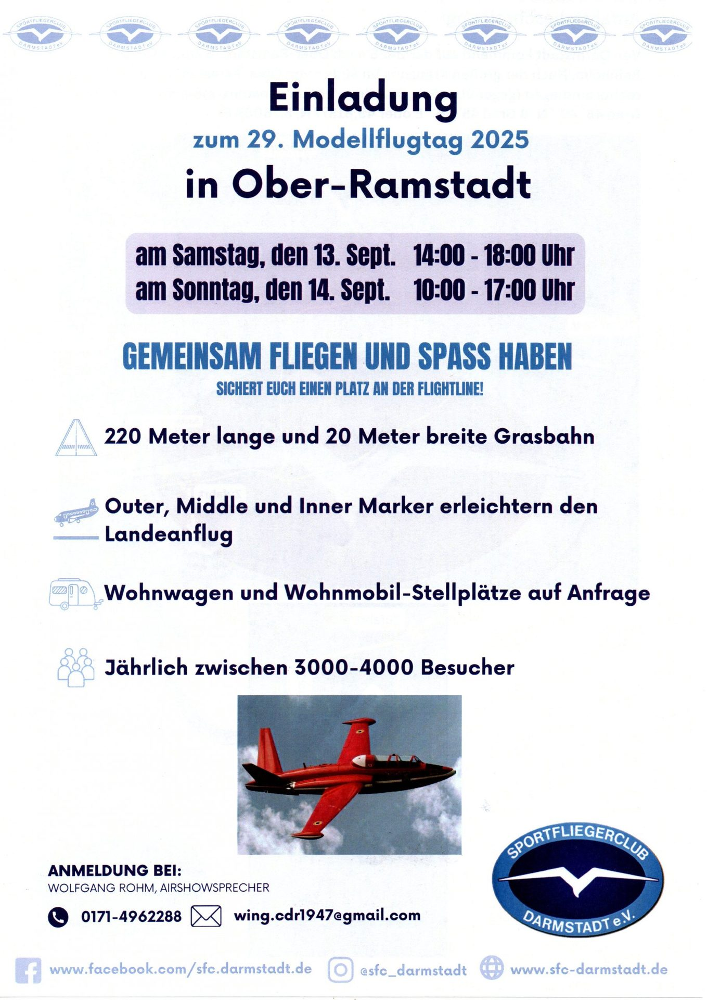
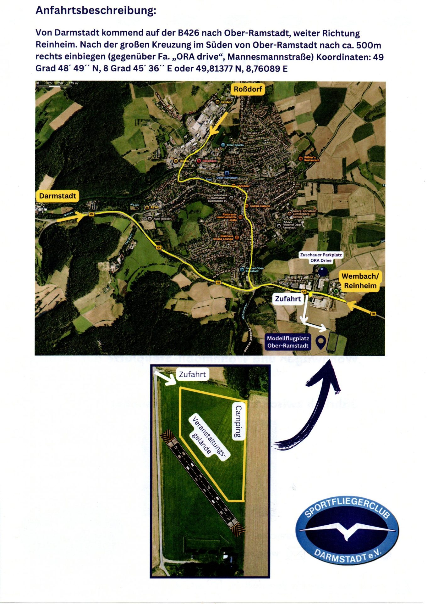
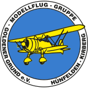
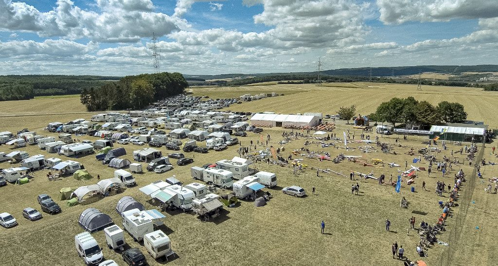

Wasserflugtreffen MFG Markdorf am Bodensee 27./28.9.25

folge den Links:

[Anmelde-Formular(PDF)](/dateien/anmelde-formularpdf.pdf)

[Einladung](/dateien/einladung.docx)

[g](/dateien/einladung.docx)

Lasst uns gemeinsam abheben!

**Modellflug-Wochenende am Samstag, den 30. August und Sonntag, den 31. August 2025

Veranstaltungsort: Modellflugplatz des Aero-Club Oestrich-Winkel

Beginn jeweils um 10:00 Uhr**

[**https://aeroclub-oestrich-winkel.de/freundschaftsfliegen/**](https://deref-web.de/mail/client/ywc36uBM-7o/dereferrer/?redirectUrl=https%3A%2F%2Faeroclub-oestrich-winkel.de%2Ffreundschaftsfliegen%2F%3Ffbclid%3DIwZXh0bgNhZW0CMTAAYnJpZBEwNThIWnU2MXl4SEFsSHZ3egEelLj4XgL0Yf5qan2hNh_lsJf0yNYXeJt-_LjlRzl1lQd8HEnbtaxKmNiZSpo_aem_DdfxELug1mfrQQYDwe8yhw)

Alle interessierten sind herzlich eingeladen, mit uns gemeinsam ein großartiges Modellflug-Wochenende zu verbringen.

**Verpflegung & Gemütlichkeit**

- Der Grill steht bereit- bitte bringt euch Verpflegung mit.
- Kaffee und Kuchen sind vorhanden.

**Camping & Übernachtung**

Camping ist auf dem Vereinsgelände ist möglich – bitte über die Pilotenregistrierung anmelden, da der Platz begrenzt ist.

Wichtig:

Kein Strom (220 V) und Wasser sind auf dem Gelände

Akkus können über unsere PV-Anlage (24 V) geladen werden.

→ Ladegerät muss für 30 V Eingangsspannung geeignet sein.

<image006.png>

**Flugbetrieb**

Max. Flughöhe: 500 m ü. G.

Max. Abfluggewicht: 25 kg.

Weitere Details zum Platz: siehe [Flugordnung](https://deref-web.de/mail/client/bJ0esL-hNHI/dereferrer/?redirectUrl=https%3A%2F%2Faeroclub-oestrich-winkel.de%2Fflugplatz%2F%23flugordnung)

**Jetzt anmelden & dabei sein!**

[**Zur Pilotenregistrierung**](https://deref-web.de/mail/client/05O2Xd24XHc/dereferrer/?redirectUrl=https%3A%2F%2Faeroclub-oestrich-winkel.de%2Fanmeldung-freundschaftsfliegen%2F)**»**

(Bitte vorab anmelden, dass erleichtert uns die Planung – vielen Dank.)

**Wir freuen uns auf ein tolles Wochenende mit euch!**

Viele Grüße und Happy Landings,

**Aero-Club Oestrich-Winkel e.V.**

Flugtag Hünfelden-Kirberg folge dem Link

[MFG_Plakat_Flugtag_2025_A4_komprimiert](/dateien/mfg-plakat-flugtag-2025-a4-komprimiert.pdf)
