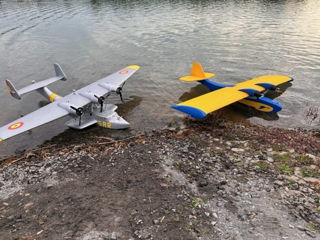
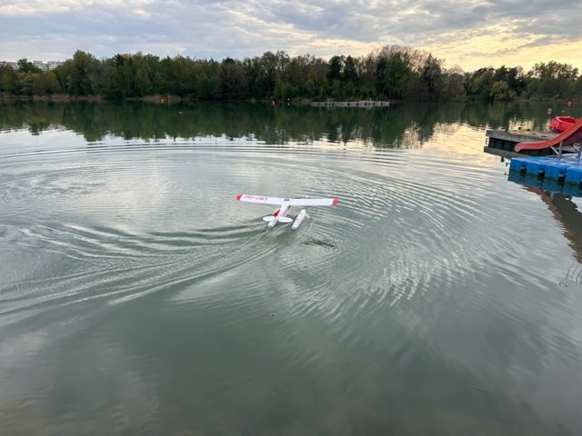
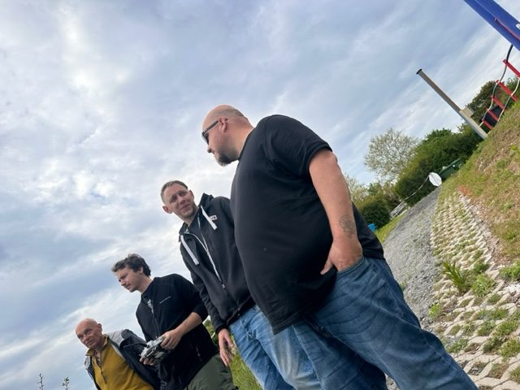

Am 22.04.2025 hatten wir die Möglichkeit vor Beginn der Badesaison am Badesee Niederroden den ersten Kontakt mit dem kühlen Nass und unseren Modellen herzustellen.

Nachfolgend ein paar Fotos und Movies

Link zum Movie:

[IMG_1563 (5)](/dateien/img-1563-5-1.mov)

[IMG_1564 (9)](/dateien/img-1564-9.mov)
