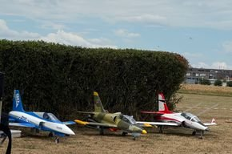
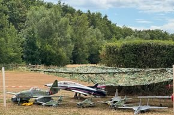
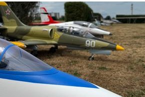
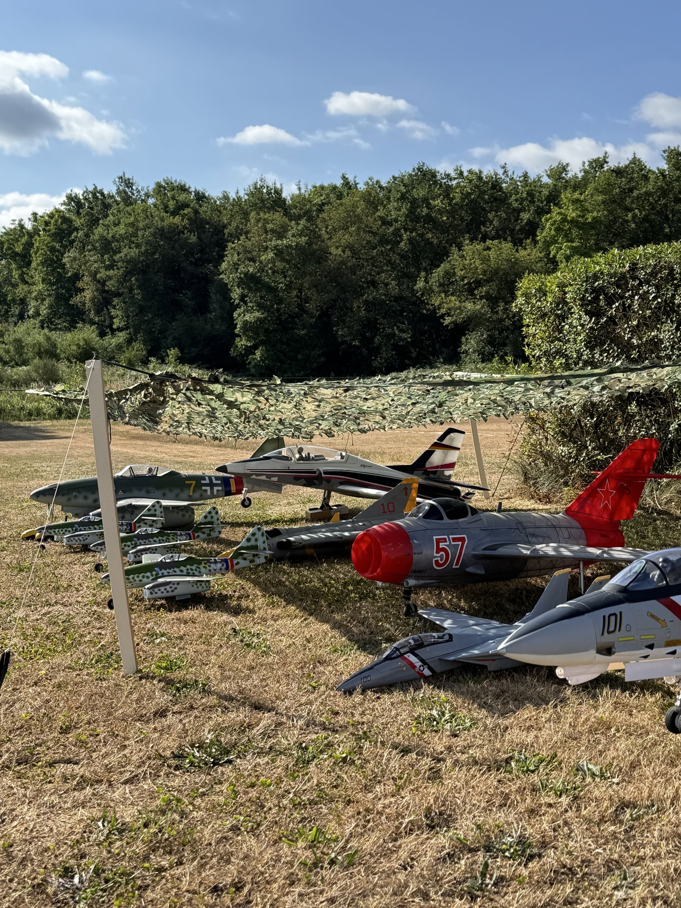
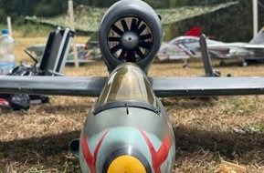
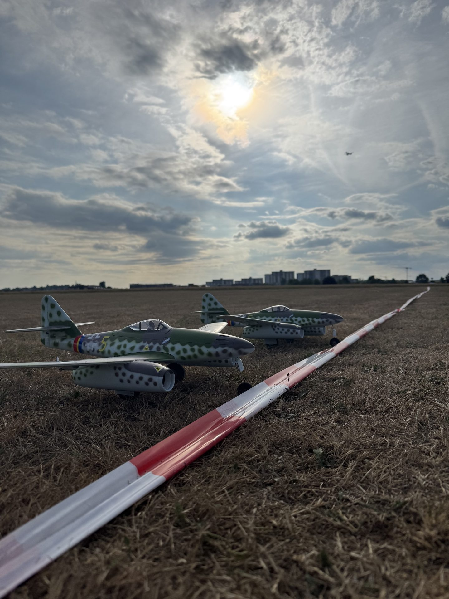

Erstes Staubsaugertreffen beim FMC Dietzenbach\
*Wir haben gesaugt wie verrückt, der Platz war so sauber wie noch nie.*

Tatsächlich hat aber jeder die Einladung richtig verstanden, niemand hat einen Staubsauger mitgebracht, dafür aber haben die gut 20 Piloten fast 40 EDF und Jet Modelle an den Start gebracht.

Erwartungsgemäß war der Nachbau des „Homebuild“ Jets von Viper Aircraft, das am meisten geflogene Modell an diesem Tag, alleine von der Freewing Viper 80 waren 8 Exemplare am Platz, einige davon in eigens angefertigtem Design. Spektakulär vorgeflogen wurden aber auch die beiden Giant-Scale Black Horse Viper von Selena und Wolfgang. Trotz der Größe kamen beide Piloten bestens mit dem schwierigen Anflug und der recht kurzen Bahn zurecht.

Atemberaubend war auch das Display einer F-104 Starfighter. Das federleichte riesige Modell mit enormem Schub wurde vom Pilot Manfred per Handstart nahezu in die Luft gelegt und zog dann im Hoovern, ja fast Torquen nach oben. Nach einigen schnellen und langsamen Überflügen konnte das Modell problemlos gelandet werden.

Auch meine komplett aus PLA 3D-gedruckte und recht große MIG 15, gefeuert von 10 S mit einem 90 mm WEMOTEC EDF zeigte sich heute von Ihrer besten Seite. Es war echt windstill, so konnte ich die MIG sehr tief und schnell über den Platz jagen.

Ein spektakuläres Display lieferten auch die beiden großen Jets, Freewing MIG 29 geflogen von Jochen und die Freewing F-14 TomCat von Thore. Mit diesen beiden Modellen am Himmel kam echtes Top-Gun Feeling auf. Wer kennt nicht das spektakuläre Flugbild der TomCat mit angelegten Flügeln. Obwohl es erst der dritte Flug war und der erste in Dietzenbach zähmte Thore den Kater mit zwei hervorragenden Landungen. Dank des Umkehrschubes reichte auch die kurze Bahn völlig aus. Jochen hingegen landete die MIG 29 mit einem „High Alpha“ Anflug und benötigte somit nur ein paar Meer Rollstecke.

Eine ganz neue Klasse der EDF Fliegerei zeugte uns Vater Martin und Tochter Selena mit Ihren Super-Orchideen mit EDF auf dem Rücken. Diese Modelle definieren Segelflug völlig neu. Mit sicherlich deutlich über 200 km/h fegten die Segelflieger über den Platz mit anschließendem Steigflug auf die zugelassenen 100m in 1-2 Sekunden. Ja selbst der Segelflug Trainer von MPX mit einem EDF auf dem Rücken und geflogen von Selena konnte mit enormen Geschwindigkeiten überzeugen.

Klein aber nicht aus schlechter Werkstatt zeigten sich drei Me262 von E-Flight. Es könnten fast Saalflugmodell sein, mit zwei 30mm EDF und nur 60 cm Spannweite. Doch die 262 sind ziemlich schnell unterwegs mit schrillem Kreischen der kleinen EDFs. Auf dem Rasen des FMCD ist sogar ein Bodenstart mit diesen keinen Modell möglich.

Pech hatte leider Joell mit seinem Sebart Avanti. Mit einem sehr schnellen und tiefen Überflug reizte er doch eine unserer Kanadischen Springfichten zu sehr, sodass sie zu Seite sprang und den Avanti abrupt stoppte. Übrig geblieben sind leider nur noch Kunststoff Kügelchen und ein geplatzter Akku, der aber noch gut 25 m weit geflogen ist.

So waren den ganzen Tag über unsere Staubsauer in der Luft. Aber auch unser Catering Team zeigte sich sehr zufrieden. Alle eingekauften und vorbereiteten Speisen konnten vollständig ausgegeben werden.

Insgesamt war das Treffen eine gelungene Veranstaltung. Der FMCD bedankt sich bei allen Piloten für ihre Displays und die sehr große Disziplin mit der hier geflogen wurde.

Unser Dank gilt auch den vielen Helfern vom FMCD vor und hinter den Kulissen, ohne Euch wäre so eine Veranstaltung nicht möglich

Wir werden das im nächsten Jahr wiederholen!

*Aus Datenschutzgründen werden im Bericht nur Vornamen genannt.*

Holm Und Rippenbruch\
**der Vorstand des Flug- und Modellbau Club Dietzenbach e. V. ,**\
i. A. Thore Lorenz/Ralf Kaiser\
*Bericht verfasst unter Zuhilfenahme von menschlicher Intelligenz!*

