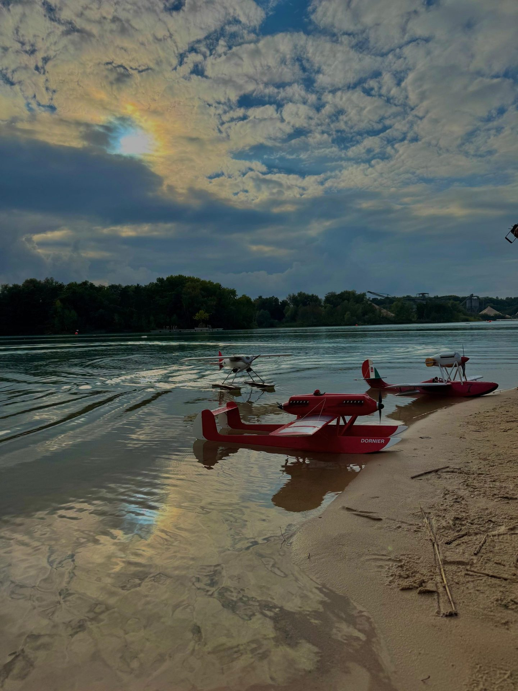
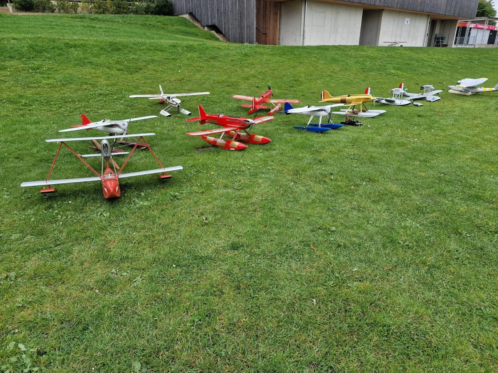
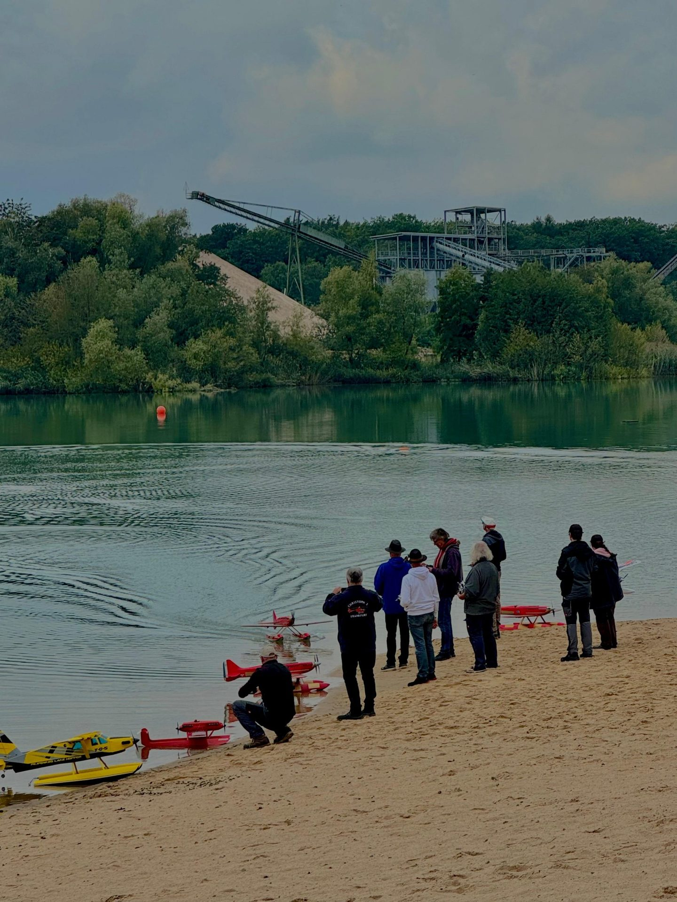
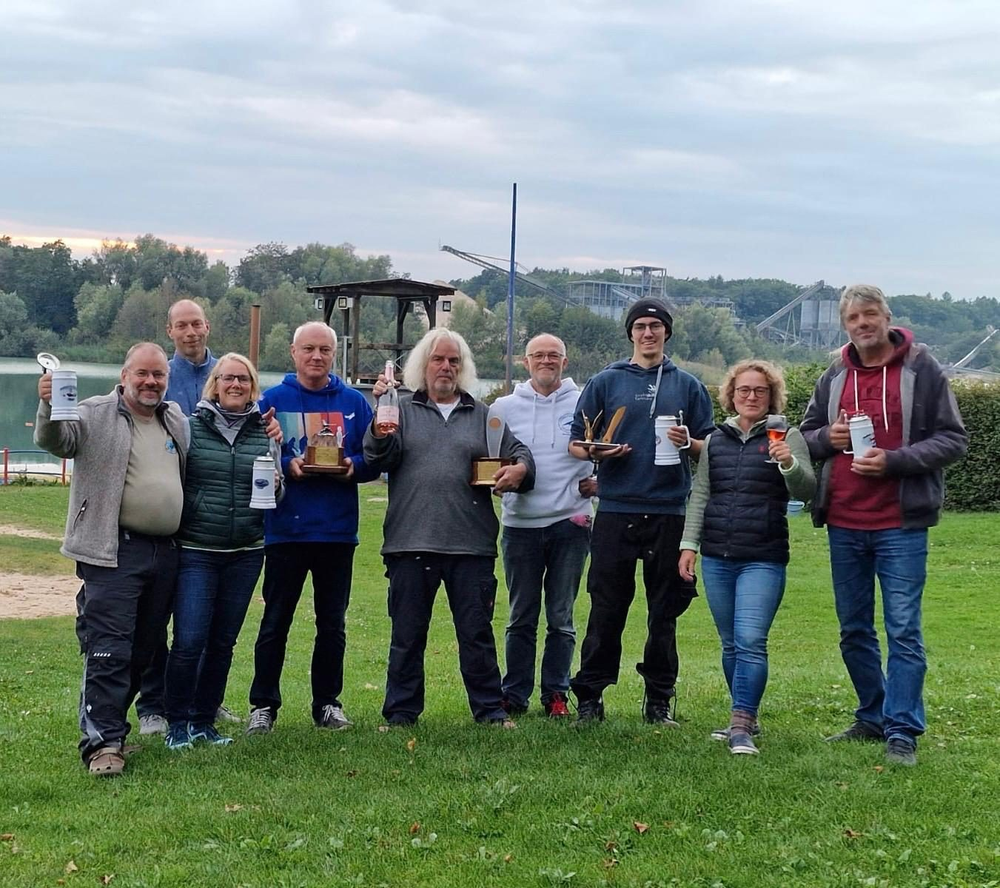

**Zweimal „Treppchen“ für heimische Modellflieger**

Am Wochenende vom 25. bis 28.September brummten wieder die Rennmotore am Strandbad in Nieder-Roden. Eine Woche früher als üblich, an dem traditionellen Termin um den Nationalfeiertrag 3. Oktober, trafen sich wieder die Modell Rennpiloten aus ganz Deutschland und sogar aus Wien in Österreich, um das in den Dreißiger Jahren berühmte Flugzeugrennen um die *Schneider Trophy* im Modellmaßstab nachzufliegen. Anders auch der Austragungsort, gemäß den Regularien ist der Vorjahresgewinner für die Austragung verantwortlich. Allerdings ist das Gewässer vom Sieger in 2024 *Rene K.* an dem recht großen Sedlitzer See im Osten Deutschlands gelegen und dort herrschen im Früherbst meist sehr böige Ostwinde, welche für eine hohe Welle auf den Wasser verantwortlich sind. Viel zu hoch für die sehr sensiblen Rennflugzeuge. So entschieden die Teilnehmer bereits sehr früh im Jahr, das Rennen in 2025 wieder in „Saint Tropez am Baggersee“ auszutragen. Nicht nur die meist sehr ruhige Wasseroberfläche, sondern auch die perfekte Infrastruktur rund um den See, begeistert die Modellpiloten. An dieser Stelle nochmal ein herzliches Dankeschön and die Stadt Rodgau für die sehr großzügige Bereitstellung des Strandbades.\
Am Anreisetag herrschte zwar noch leichtes Regenwetter, doch bereits am Freitag Morgen war bestes Flugwetter mit fast totaler Windstille--- sehr zum Leidwesen der befreundeten Drachenflieger Aiolus, deren Drachenfest zeitgleich am Parkplatz des Strandbades stattfand.\
Die 10 Piloten mit 16 Rennflugzeugen absolvierten am Freitag und Samstag Ihre Pflichtflüge und bereits am Zwischenergebnis am Samstag Mittag war zu erkennen, dass es wieder eine knappe Entscheidung zwischen den bekannten Platzhirschen Rene, Thore und Ralf geben wird, ebenfalls unter den Favoriten war auch Andy, der Rennpilot aus Wien. Umso spannender wurde die Rennleitung am Samstag Abend erwartet, mit dem Endergebnis und dabei gab es großen Jubel der Mitglieder vom Flug und Modellbau Club Dietzenbach. Wieder einmal hat es der „Präsi“ geschafft mit einer Abweichung von gerade mal 0.01% seine altbewährte Macchi M-72 über die Ziellinie zu fliegen. Zweiter im Bunde der Andy mit einer Niuport Delarge und nochmal großer Jubel im Dietzenbacher Lager, unser Pressewart Thore steuerte seine Macchi 33 auf den dritten Platz.\
**Herzlichen Glückwunsch an die Gewinner**.

Erwähnenswert ist es, dass die Abweichung des letzt-platzierten Rennflieger auch nur 2% betrug.\
Bei diesem Rennen gilt es die Höchstgeschwindigkeit des Originals, mit einer Formel auf den Modellmaßstab heruntergerechnet, innerhalb von drei Renndurchgängen, so genau wie möglich zu erreichen.\
Das nächste Rennen wird im Oktober 2026 vom Zweitplatzierten organisiert und  am herrlichen Traunsee in Österreich stattfinden.

Thore Lorenz\
Pressewart des FMCD, im Oktober 2025

Erstellt unter Zuhilfenahme von menschlicher Intelligenz

