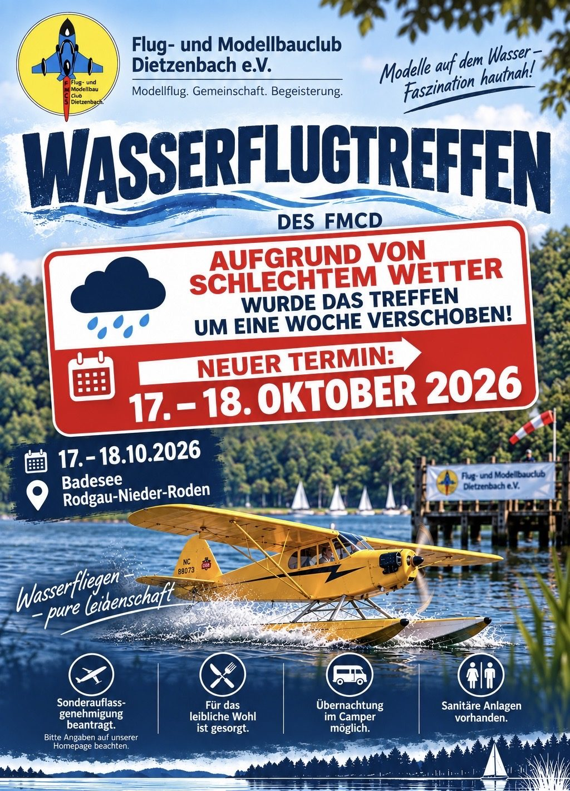
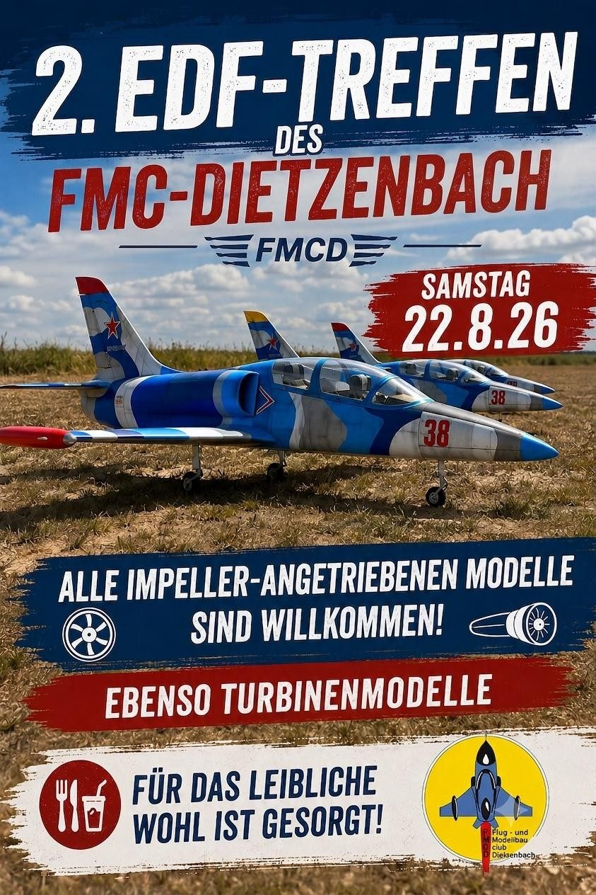

## Achtung Terminänderung !!!

**Einladung zum Wasserflugtreffen des FMCD**

Der **Flug- und Modellbauclub Dietzenbach e.V.**  lädt herzlich zum **Wasserflugtreffen 2026** ein!

Am **17. und 18. Oktober 2026** dreht sich am **Badesee in Rodgau-Nieder-Roden** alles um das Modellfliegen auf dem Wasser. Ob erfahrener Wasserflieger, neugieriger Pilot oder interessierter Zuschauer – wir freuen uns auf ein gemeinsames Wochenende mit außergewöhnlichen Modellen, schönen Flügen und vielen Gesprächen unter Modellflugbegeisterten.

**Piloten** sind herzlich eingeladen, ihre Wasserflugmodelle mitzubringen und unseren See ausgiebig zu nutzen. Für die Veranstaltung ist eine **Sonderauflassgenehmigung für Modelle bis 25 kg, auch mit Verbrennungsmotoren**, beantragt. Die endgültige Zusage steht noch aus, wird aber auf Unserer Homepage veröffentlicht werden.

Natürlich sind auch **Zuschauer, Familien und Modellfluginteressierte** herzlich willkommen. Kommt vorbei, erlebt Wasserflugmodelle aus nächster Nähe und genießt die besondere Atmosphäre direkt am See.

Für das **leibliche Wohl** ist gesorgt. **Sanitäre Anlagen** sind vorhanden und es besteht die Möglichkeit, **mit dem Camper vor Ort zu übernachten**.

**📅 17.–18. Oktober 2026\📍 Badesee Rodgau-Nieder-Roden**

Wir freuen uns auf zahlreiche Piloten, spannende Modelle, interessierte Zuschauer und ein schönes gemeinsames Wochenende am Wasser.

**Euer Flug- und Modellbauclub Dietzenbach e.V.**\
**Wir sehen uns am See!**

Einladung zum 2. EDF-Treffen des FMCD

Liebe Modellflugfreundinnen und Modellflugfreunde,

nach dem erfolgreichen ersten Treffen freuen wir uns sehr, euch herzlich zu unserem\
2. EDF- / Impellertreffen einzuladen!

Ort: Fluggelände des FMCD Dietzenbachs\
Datum: 22.08.2026\
Schwerpunkt: EDF- / Impellermodelle aller Art

Die Anreise ist bereits ab Freitag, den 21.08.2026 möglich, und ihr könnt bis einschließlich Sonntag, den 23.08.2026 bei uns bleiben. Sowohl Tagesgast als auch Wochenendgast – alle sind willkommen.

Egal ob Sportjet, Scale-Modell oder Eigenbau – Wir wollen alle sehen! Natürlich sind auch Turbinenmodelle gern gesehen.\
Im Vordergrund stehen der gemeinsame Flugspaß, der Erfahrungsaustausch und das gemütliche Beisammensein unter Gleichgesinnten. Zuschauer sind ebenfalls herzlich eingeladen.\
Für unsere Planung bitten wir euch, uns kurz Bescheid zu geben, ob ihr teilnehmt und wie lange ihr bleiben möchtet (z. B. Freitag–Sonntag oder nur einen Tag). Dafür schreibt gerne eine kurze Rückmeldung an [vorstand@fmc-dietzenbach.org](mailto:vorstand@fmc-dietzenbach.org)\
Für das leibliche Wohl ist gesorgt.

Wir freuen uns auf viele Teilnehmer, spannende Modelle und ein großartiges gemeinsames Wochenende mit euch!

Mit sportlichen Grüßen\
Der Vorstand des FMCD

- 2026 wird es wieder jeden ersten Dienstag im Monat, in der Badesession, ab 20Uhr Wasserflug am Badesee Nieder-Roden geben.
- Bis Ende März findet noch das Hallenfliegen statt.
- Geplantes Schnupperfliegen am Flugplatzgelände im Mai
- Vom 17.-19.04.2026 ist Wasseranstellen auf der Wasserkuppe.
- Vom 04.-07.06. 2026 findet der Vereinsausflug auf die Wasserkuppe statt.
- 10.-12.07.2026 ist die Flugplatzkerb Gelnhausen.
- 22.08.2026 Staubsaugertreffen.
- **02.-04.10.2026 ist die Schneider Trophy am Traunsee in Österreich**
- **10.-11.10.2026 ist das Wasserflugtreffen am Badesee Nieder-Roden.**
- Am 1 Adventwochenende wird der Verein auf dem Weihnachtsmarkt in  Dietzenbach einen Stand haben.
